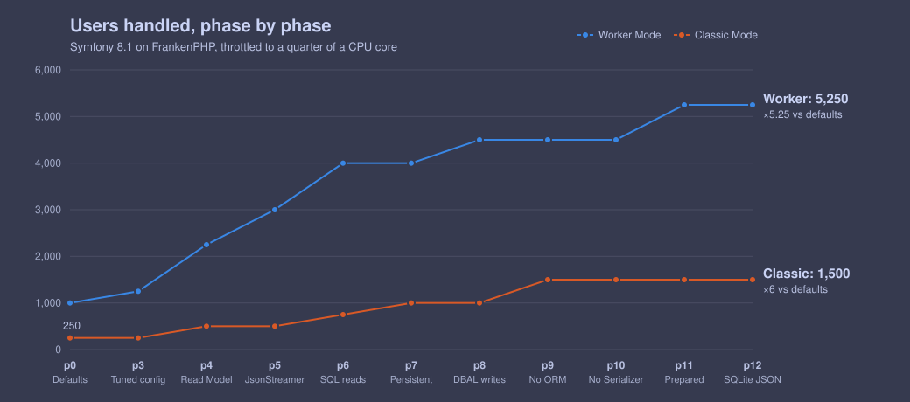
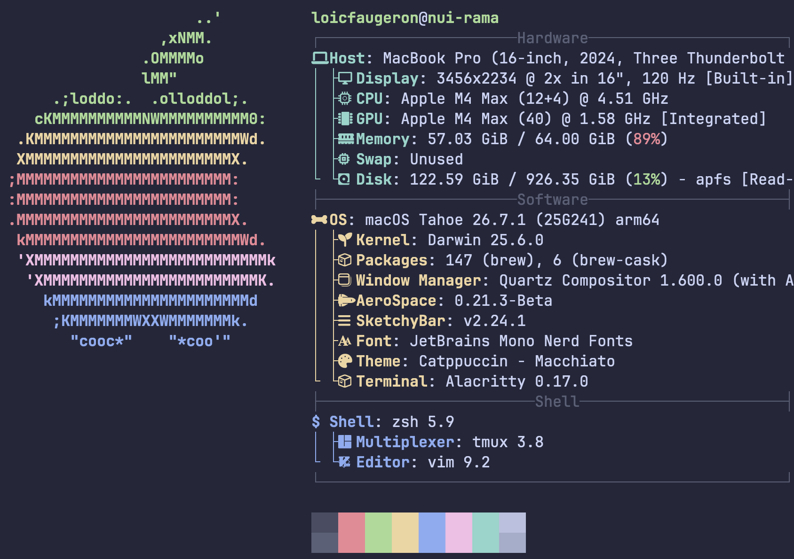

[Arjay McCandless](https://www.youtube.com/@arjay_the_dev), an ex Amazon Backend Engineer,
published an interesting challenge:

* [How Many Users Can a $12 Server Handle?](https://www.youtube.com/watch?v=GFtFIxrAjIs)
* [Which Programming Language Can Handle the Most Users on a $12 Server?](https://www.youtube.com/watch?v=sQXFhh_PiG4)
* [I Asked Expert Programmers to Max Out a $12 Server](https://www.youtube.com/watch?v=QGWKCaglSBI)

I really like his down to earth and realistic approach,
but I don't find the final scores representative:

> **Arjay**: plz submit some real world app<br>
> <br>
> **Go dev**: _batches 250 `INSERT` per commit in a single goroutine_ (53k users)<br>
> **Fortran dev**: _validates JWTs in the database_ (70k)<br>
> **PHP dev**: _writes a 120 loc single file app with Swoole C extension_ (71k)<br>
> **C++ dev**: _handrolls HTTP / JSON parsers_ (71k)<br>
> **C dev**: _starts optimising their own SQLite_ (172k)<br>
> **Rust dev**: _gets the kernel to manage socket references_ (264k)<br>

Today, we're going to show what an idiomatic Symfony 8.1 app with Doctrine and FrankenPHP
(classic, which is equivalent to PHP-FPM) can do. And then show what FrankenPHP Worker Mode can do even better.

And before anyone comments with "Swoole / FrankenPHP? That's not PHP, that's C / Go!",
let me remind you that FPM, Apache and Nginx are all written in C, as well as PHP itself.

Nobody says Node isn't JavaScript because its HTTP parser is C, right?

> **TL;DR**:<br>
> <br>
> The following optimisations gave us the biggest gains:<br>
> <br>
> - _Classic_: Persistent Connection (+49%), No ORM (+35%), Read Model (+34%)<br>
> - _Worker_: Read Model (+67%), JsonStreamer (+34%), Plain SQL Reads (+31%)<br>
>
> 

Now, sharpen your attention (it's going to be a long, human made, article), and...<br>
_Let's get technical, technical, let's get technical, ooh 🎶_.


* [The rules](#the-rules)
* [Defaults (p0)](#defaults): Symfony / Doctrine out of the box
* [Benchmarking](#benchmarking)
* [Tuned Config (p1-p3)](#tuned-config): php.ini, preload and JIT
* [Read Model (p6)](#read-model): DQL `NEW` instead of entities
* [JsonStreamer (p7)](#jsonstreamer): Generated JSON writers instead of the Serializer
* [Plain SQL Reads (p8)](#plain-sql-reads): DBAL reads
* [Persistent Connection (p9)](#persistent-connection): SQLite stays open between requests
* [DBAL instead of ORM (p10-p11)](#dbal-instead-of-orm): DBAL writes, then no ORM
* [Extract Till You Drop (p12-p14)](#extract-till-you-drop): Less framework, more SQLite
* [Experiments](#experiments): What didn't make a difference
* [Conclusion](#conclusion): It's over 9000!!!!

## The rules {#the-rules}

The idea is to use a "cheap" server with 1 vCPU and 2 GB RAM,
make a micro-blogging app that uses SQLite
(and my rule: the code should be something you find at work, not tailored to beat the benchmark),
then use [k6](https://k6.io/) to simulate realistic user behaviour, at scale:

```javascript
import http from 'k6/http';
import { check, sleep } from 'k6';
import { SharedArray } from 'k6/data';

// VUS = Virtual UserS
const VUS = Number(__ENV.VUS || 100);
const BASE_URL = __ENV.BASE_URL || 'http://127.0.0.1:3000';
const LIKE_PROB = 0.15;
const POST_PROB = 0.02;
const tokens = new SharedArray('tokens', () => JSON.parse(open(__ENV.TOKENS || '../seed/tokens.json')));

export const options = {
  scenarios: {
    users: {
      executor: 'ramping-vus',
      stages: [
        // 01 min ramp-up: allowing to create users progressively
        { duration: __ENV.RAMP_UP || '60s', target: VUS },

        // 05 min hold
        { duration: __ENV.DURATION || '5m', target: VUS },

        // 30 sec ramp-down: bring users gradually to 0
        { duration: '30s', target: 0 },
      ],
      // 10 s grace for users to finish their loop during ramp-down
      gracefulRampDown: '10s',
    },
  },

  // To find the number of users the app can handle, we use the following criteria:
  thresholds: {
    // 95% of requests must be answered in under 500 ms
    // 99% under 1 s
    http_req_duration: ['p(95)<500', 'p(99)<1000'],

    // fewer than 1% request failure
    http_req_failed: ['rate<0.01'],
  },
  summaryTrendStats: ['avg', 'med', 'p(95)', 'p(99)', 'max'],
};

const between = (lo, hi) => lo + Math.random() * (hi - lo);

export default function () {
  const user = tokens[(__VU - 1) % tokens.length];
  const auth = { headers: { Authorization: `Bearer ${user.token}`, 'Content-Type': 'application/json' } };

  // 0. First iteration only: wait between 0 to 5 seconds, to avoid thundering herd
  if (__ITER === 0) sleep(between(0, 5));

  // 1. Load the feed
  const feed = http.get(`${BASE_URL}/feed`, { tags: { name: 'GET /feed' } });

  // 1.1 If feed fails, wait between 3 to 7 seconds before starting the loop again
  if (!check(feed, { 'feed 200': (r) => r.status === 200 })) { sleep(between(3, 7)); return; }

  const posts = feed.json('posts');
  const post = posts[Math.floor(Math.random() * posts.length)];

  // 2. Wait between 3 to 7 seconds
  sleep(between(3, 7));

  // 3. Open a random post from the feed
  check(http.get(`${BASE_URL}/posts/${post.id}`, { tags: { name: 'GET /posts/:id' } }), { 'post 200': (r) => r.status === 200 });
 
  // 4. Wait between 3 to 8 seconds
  sleep(between(3, 8));

  // 5. 15% chance to like the post
  if (Math.random() < LIKE_PROB) {
    const r = http.post(`${BASE_URL}/posts/${post.id}/like`, null, { ...auth, tags: { name: 'POST /posts/:id/like' } });
    check(r, { 'like 200/201': (r) => r.status === 200 || r.status === 201 });
  }

  // 6. 2% chance to write a post
  if (Math.random() < POST_PROB) {
    const body = JSON.stringify({ body: `${user.username} says hi at ${new Date().toISOString()} (VU ${__VU}, iter ${__ITER})` });
    check(http.post(`${BASE_URL}/posts`, body, { ...auth, tags: { name: 'POST /posts' } }), { 'create 201': (r) => r.status === 201 });
  }

  // 7. Wait between 5 to 15 seconds
  sleep(between(5, 15));
}
```

The endpoints are:

* `GET /feed`: `200`, `{"posts":[<post>, ...]}`
* `GET /posts/:id`: `200`, `{"post":<post>}`
* `POST /posts/:id/like`: `201` or `200`, `{"liked":true,"already_liked":<bool>,"post_id":<int>}`
* `POST /posts`: `201`, `{"post":<post>}`

> _Note_: with `<post>` being:
>
> ```json
> {
>   "id": <postitive integer, e.g. 23>,
>   "body": <non empty string, e.g. "Here I am, brain the size of a planet, and they ask me to serve JSON.">,
>   "created_at": <string (ISO 8601 datetime) e.g. "2025-05-25T13:37:00.409Z">,
>   "author": <non empty string, e.g. "Marvin">,
>   "like_count": <non negative integer, e.g. 42>
> }
> ```

We start with at 2500 virtual users, then double until it fails,
to finally narrow it down to within 5%.

The highest level that holds for 5 minutes is the score.

Oh and there's a seed with 50k pre-signed JWT credentials,
every virtual user logs in as one of them (above 50k virtual users, some share a login).

## Defaults (p0) {#defaults}

I went with a PHP 8.5, Symfony 8.1, Doctrine (DBAL 4.5 / ORM 3.7) app,
and tried to keep it as idiomatic as possible,
running on FrankenPHP once in "classic" mode and once in "worker" mode:

* "classic": the PHP app boots once per request then dies once the response is served,
  this is what PHP-FPM does and FrankenPHP in Classic Mode is
  [proven to be as performant as PHP-FPM](https://www.youtube.com/watch?v=1yQubrkwzz4)
* "worker": the PHP app boots once per worker, then each worker handles requests one after another in a loop

### Controller

Let's start with the controller:

```php
final class PostController extends AbstractController
{
    private const int FEED_SIZE = 20;

    public function __construct(
        private readonly PostRepository $posts,
        private readonly PostLikeRepository $likes,
        private readonly EntityManagerInterface $entityManager,
    ) {
    }

    #[Route('/feed', methods: ['GET'])]
    public function feed(): JsonResponse
    {
        return $this->json([
            'posts' => $this->posts->findLatest(self::FEED_SIZE),
        ]);
    }

    #[Route('/posts/{id}', methods: ['GET'])]
    public function show(
        #[ValueResolver(PostId::class)]
        int $id,
    ): JsonResponse {
        return $this->json([
            'post' => $this->posts->find($id)
                ?? throw new NotFoundHttpException('post not found'),
        ]);
    }

    #[Route('/posts', methods: ['POST'])]
    public function create(
        #[CurrentUser]
        JwtUser $user,
        #[MapRequestPayload(validationFailedStatusCode: Response::HTTP_BAD_REQUEST)]
        CreatePostPayload $payload,
    ): JsonResponse {
        $author = $this->entityManager->getReference(User::class, $user->id)
            ?? throw new \LogicException('user reference not available');

        $post = Post::fromPayload($author, $payload);
        $this->entityManager->persist($post);
        $this->entityManager->flush();

        return $this->json([
            'post' => $post,
        ], Response::HTTP_CREATED);
    }

    #[Route('/posts/{id}/like', methods: ['POST'])]
    public function like(
        #[CurrentUser]
        JwtUser $user,
        #[ValueResolver(PostId::class)]
        int $id,
    ): JsonResponse {
        $post = $this->posts->find($id)
            ?? throw new NotFoundHttpException('post not found');
        $liker = $this->entityManager->getReference(User::class, $user->id)
            ?? throw new \LogicException('user reference not available');

        $alreadyLiked = null !== $this->likes->findOneBy([
            'user' => $liker,
            'post' => $post,
        ]);
        if (!$alreadyLiked) {
            try {
                $this->entityManager->persist(new PostLike(
                    $liker,
                    $post,
                ));
                $this->entityManager->flush();
            } catch (UniqueConstraintViolationException) {
                $alreadyLiked = true; // liked by a concurrent request
            }
        }

        return $this->json([
            'liked' => true,
            'already_liked' => $alreadyLiked,
            'post_id' => $id,
        ], $alreadyLiked ? Response::HTTP_OK : Response::HTTP_CREATED);
    }
}
```

### VO and Validation

We make use of the Validator component with the Value Object for the `POST /posts` payload:

```php
final readonly class CreatePostPayload
{
    public function __construct(
        #[Assert\Sequentially([
            new Assert\Type('string', message: 'body is required'),
            new Assert\NotBlank(message: 'body is required', normalizer: 'trim'),
            new Assert\Length(max: 500, normalizer: 'trim', maxMessage: 'body must be at most 500 characters'),
        ])]
        public mixed $body = null,
    ) {
    }
}
```

### Doctrine Entity and Serializer

We use a regular Doctrine Entity for Posts, and the Symfony Serializer component:

```php
#[ORM\Entity(repositoryClass: PostRepository::class)]
#[ORM\Table(name: 'posts')]
class Post
{
    #[ORM\Id]
    #[ORM\GeneratedValue]
    #[ORM\Column]
    private ?int $id = null;

    #[ORM\Column(length: 500)]
    private string $body;

    /**
     * SQLite has no DateTime type, so the challenge specifies the following in the schema:
     * `created_at TEXT NOT NULL DEFAULT (strftime('%Y-%m-%dT%H:%M:%fZ', 'now'))`
     */
    #[ORM\Column(insertable: false, updatable: false, generated: 'INSERT')]
    private string $createdAt;

    #[ORM\ManyToOne]
    #[ORM\JoinColumn(name: 'user_id', nullable: false)]
    private User $author;

    /** @var Collection<int, PostLike> */
    #[ORM\OneToMany(targetEntity: PostLike::class, mappedBy: 'post', fetch: 'EXTRA_LAZY')]
    private Collection $likes;

    private function __construct(User $author, string $body)
    {
        $this->author = $author;
        $this->body = $body;
        $this->likes = new ArrayCollection();
    }

    public static function fromPayload(User $author, CreatePostPayload $payload): self
    {
        if (!\is_string($payload->body)) {
            throw new \LogicException('body must be validated first');
        }

        return new self(
            $author,
            trim($payload->body),
        );
    }

    public function getId(): ?int
    {
        return $this->id;
    }

    #[Ignore]
    public function getAuthor(): User
    {
        return $this->author;
    }

    public function getBody(): string
    {
        return $this->body;
    }

    #[SerializedName('created_at')]
    public function getCreatedAt(): string
    {
        return $this->createdAt;
    }

    #[SerializedName('author')]
    public function getAuthorUsername(): string
    {
        return $this->author->getUsername();
    }

    #[SerializedName('like_count')]
    public function getLikeCount(): int
    {
        return $this->likes->count();
    }
}
```

> _Note_: The challenge requires the JSON to have the fields in a specific order:
>
> ```json
> {"id": ..., "body": ..., "created_at": ..., "author": ..., "like_count": ...}
> ```
>
> Without the Serializer attributes, our `Post` Entity would serialise with fields:
> in "getter" order, in camelCase, with no `like_count`, and `author` being the whole `User` Entity:
>
> ```json
> {
>   "id": ...,
>   "author": {"id": ..., "username": ..., "createdAt": ...},
>   "body": ...,
>   "createdAt": ...
> }
> ```

In `getLikeCount()`, the `$this->likes->count()` call would trigger a
`SELECT ... FROM likes WHERE post_id = ?` (42 likes = 42 rows returned),
but since we're using `EXTRA_LAZY` it becomes the intended `SELECT COUNT(*) FROM likes WHERE post_id = ?`.

> _Note_: Whenever you have to use `EXTRA_LAZY`,
> this is pretty much a hint telling you you shouldn't be using the ORM here.

Yet we still have a problem: the Serializer calls `getLikeCount()` on each post,
so for example in the `GET /feed` endpoint we issue one query that returns the 20 posts,
then 20 more queries to get the count for each.

This is a N+1 query problem which we'll fix in the [Read Model section](#read-model).

### Doctrine Repository

In the controller, for the `GET /feed` endpoint we use the following Doctrine Repository:

```php
class PostRepository extends ServiceEntityRepository
{
    public function __construct(ManagerRegistry $registry)
    {
        parent::__construct($registry, Post::class);
    }

    /** @return list<Post> */
    public function findLatest(int $limit): array
    {
        return $this->createQueryBuilder('p')
            ->addSelect('u')
            ->join('p.author', 'u')
            ->orderBy('p.createdAt', \SortDirection::Descending)
            ->addOrderBy('p.id', \SortDirection::Descending)
            ->setMaxResults($limit)
            ->getQuery()
            ->getResult();
    }
}
```

If we were calling directly `$this->posts->findBy([], ['createdAt' => 'DESC', 'id' => 'DESC'], 20)`,
Doctrine ORM would issue a first `SELECT ... FROM posts ORDER BY ... LIMIT 20` query,
followed by 20 `SELECT ... FROM users WHERE id = ?` to get the author's username of each post.

Instead our `findLatest()` method uses a "fetch join" (`addSelect()` + `join()`):
`SELECT posts.*, users.* FROM posts INNER JOIN users ORDER BY ... LIMIT 20`,
saving us from a second N+1 query trap.

### Firewall config

For the authentication and authorization of users, we rely on Symfony's SecurityBundle:

```yaml
security:
    # Users come from verified JWTs (see App\Security\JwtAccessTokenHandler), they're never loaded.
    providers:
        users_in_memory: { memory: null }

    firewalls:
        main:
            lazy: true
            stateless: true
            provider: users_in_memory
            access_token:
                token_handler: App\Security\JwtAccessTokenHandler
                failure_handler: App\Security\JsonAuthenticationFailureHandler
            entry_point: App\Security\BearerTokenEntryPoint

    # Checked before the route's {id} is validated: a 401 wins over a 400.
    access_control:
        - { path: ^/posts, methods: [POST], roles: IS_AUTHENTICATED }
```

> _Note_: We had to handroll our JWT verification because the challenge requires
> a HMAC key that is 9 bytes shorter than what RFC 7518 specifies,
> existing libraries like firebase/php-jwt enforce the RFC requirements.

We only require authentication on the "write" endpoints (`access_control`),
because the challenge doesn't require it on the "read" ones.

### Doctrine config

Doctrine's config is the recipe's, pointed at SQLite,
minus the result cache (the challenge forbids caching data across requests):

```yaml
doctrine:
    dbal:
        driver: pdo_sqlite
        path: '%env(SQLITE_PATH)%'

        profiling_collect_backtrace: '%kernel.debug%'
    orm:
        validate_xml_mapping: true
        naming_strategy: doctrine.orm.naming_strategy.underscore
        auto_mapping: true
        mappings:
            App:
                type: attribute
                is_bundle: false
                dir: '%kernel.project_dir%/src/Entity'
                prefix: 'App\Entity'
                alias: App

# No result cache: the challenge forbids caching data across requests.
# The query cache only holds DQL to SQL translations, like a prepared statement.
when@prod:
    doctrine:
        orm:
            query_cache_driver:
                type: pool
                pool: doctrine.system_cache_pool

    framework:
        cache:
            pools:
                doctrine.system_cache_pool:
                    adapter: cache.system
```

### SQLite DBAL Middleware

The challenge (rule 6) requires some specific SQLite settings (`PRAGMA`),
but since those only last as long as the connection does,
we need to send them everytime Doctrine connects,
and this is done with a custom DBAL middleware:

```php
#[AsMiddleware]
final readonly class SqlitePragmasMiddleware implements Middleware
{
    // 2 `PRAGMA` queries
    public const array PRAGMAS = [
        // WAL (Write Ahead Logs) required for challenge: already set in the database file
        // 'journal_mode' => 'WAL', // readers don't block the writer, SQLite writes to -wal file, and copies it to db file at "checkpoints" 

        // synchronous: If the power cuts off or the OS crashes...
        // 'synchronous' => 'OFF', // ... recent transactions can be lost, and the database can be corrupted (not allowed for the challenge)
        'synchronous' => 'NORMAL', // ... last few commits can be lost but database stays consistent; done on "checkpoint" 
        // 'synchronous' => 'FULL', // ... nothing committed is lost; done on every commit

        'busy_timeout' => '5000',  // wait for the write lock instead of failing with SQLITE_BUSY
    ];

    public function wrap(Driver $driver): Driver
    {
        return new class($driver) extends AbstractDriverMiddleware {
            public function connect(#[\SensitiveParameter] array $params): Connection
            {
                $connection = parent::connect($params);
                foreach (SqlitePragmasMiddleware::PRAGMAS as $pragma => $value) {
                    $connection->exec("PRAGMA {$pragma} = {$value}");
                }

                return $connection;
            }
        };
    }
}
```

> _Note_: in Classic Mode, there's 1 connection and 2 `PRAGMA` queries per request,
> in Worker Mode it happens only once per worker
> (by default Symfony's runtime will restart workers every 500 requests).

### Caddyfile

Finally, the Caddyfile, which is the FrankenPHP configuration, for Classic Mode:

```
# Caddyfile.classic
{
	auto_https off # no TLS
	admin off # no Caddy admin API

	frankenphp {
        # num_threads 2 # default: 2 per CPU

		# Worker mode disabled
		# worker {
		# 	file ./public/index.php
		# }
	}
}

http://:{$PORT} {
	bind {$HOST}
	root ./public
	# Serves static files: on every request, looks for a matching file in ./public first,
	# then falls back to index.php
	php_server
}
```

And for Worker Mode:

```
# Caddyfile.worker
{
	auto_https off
	admin off

	frankenphp {
        # num_threads 2 # default: 2 threads per CPU

        # Worker mode enabled
		worker {
		    # num 2 # default: 2 workers per CPU
			file ./public/index.php
		}
	}
}

http://:{$PORT} {
	bind {$HOST}
	root ./public
	# Serves static files: on every request, looks for a matching file in ./public first,
	# then falls back to index.php
	php_server
}
```

> _Note_: Symfony detects FrankenPHP out of the box (classic and Worker Mode),
> so no changes to the PHP code need to be made (just keep your app stateless).<br>
> <br>
> After serving the Response, Symfony resets its services (like Doctrine's EntityManager),
> so nothing leaks from one request to another (but still, keep your app stateless!).

There's no custom `php.ini`:
we use FrankenPHP's release binary, which comes with the default PHP settings.

## Benchmarking {#benchmarking}

In the video Arjay uses a DigitalOcean droplet (1 vCPU, 2 GB RAM, no swap),
but then switched to a Synteq VPS (same specs)
for the [Leaderboard](https://github.com/arjaythedev/twelve-dollar-server-challenge/blob/main/LEADERBOARD.md) (more consistent). 

> _Note_: I also recommend [never using DigitalOcean, ever](https://whateverthing.com/blog/2026/09/09/digitalocean-what-r-u-doing/).

I'll instead run everything locally with: an Ubuntu 24.04 Docker container,
pinned to the CPU core 1 (`--cpuset-cpus=1`),
throttled to a quarter of that core (`--cpus=0.25`), 2 GB of RAM and no swap.

> _Note_: I initially ran my tests without the throttling,
> then submitted my app which turned out to score much less than expected.<br>
> The much less powerful CPU turned out to be a much bigger issue for my app,
> so I had to rerun everything, which led me to find more optimisations!

I'll then run k6 in a second container, with access to the other cores
(`--cpuset-cpus=2-15`), making sure to leave core 0 for the VM
(in the video and leaderboard, Arjay runs k6 on a separate machine).

> _Note_: I'm running this on my MacBook Pro (Apple M4 Max):<br>
> * 16 CPU cores: 12 performance cores and 4 efficiency cores<br>
> * 64 GB of RAM, of which the Docker VM gets about 57 GB and all 16 cores<br>



Here's how to run:

```console
# 1. build the image
bash local-bench/bench.sh build

# 2. start the server on http://127.0.0.1:3000
SERVE_ARGS="--cpus=0.25" bash local-bench/bench.sh start

# 3. bench bench bench
# Note: 02 min warmup with 1000 users
# then use the bench/load.js script
bash local-bench/bench.sh load 1000 step-x

# 4. stop
bash local-bench/bench.sh stop
```

#### Thresholds

It will output a handful of sections:

```
  █ THRESHOLDS

    http_req_duration
    ✓ 'p(95)<500' p(95)=324.29ms
    ✓ 'p(99)<1000' p(99)=503.86ms

    http_req_failed
    ✓ 'rate<0.01' rate=0.00%
```

These are the challenge's criteria:

* 95% of requests answered in 324.29 ms, that's under 500 ms, so we get a ✓
* 99% in 503.86 ms, that's under 1 s, so we get a ✓
* 0.00% failure, that's under 1%, so we get a ✓

All three must get a ✓ to be considered a success, so a single ✗ means failure.

#### Diagnostics

```
  █ TOTAL RESULTS

    checks_total.......: 36903   92.262913/s
    checks_succeeded...: 100.00% 36903 out of 36903
    checks_failed......: 0.00%   0 out of 36903

    ✓ feed 200
    ✓ post 200
    ✓ like 200/201
    ✓ create 201
```

This section is mostly diagnostics, and can mostly be disregarded.

The first part details how we compute `http_req_failed`:
by checking the response status codes for each endpoint.

#### Latency and Volume

```
    HTTP
    http_req_duration..............: avg=87.12ms med=45.55ms p(95)=324.29ms p(99)=503.86ms max=772.54ms
      { expected_response:true }...: avg=87.12ms med=45.55ms p(95)=324.29ms p(99)=503.86ms max=772.54ms
    http_req_failed................: 0.00%  0 out of 36903
    http_reqs......................: 36903  92.262913/s
```

The HTTP subsection gives us the latency and volume:

* `http_req_duration`:
    * `avg`: average, should be more than median
    * `med`: median, the typical request
    * `p(95)` and `p(99)`: used in the score, the slowest parts
    * `max`: the single slowest request (if huge, then should be a warning) 
* `expected_response:true`: same numbers, but for successful responses only
* `http_req_failed`: 4xx, 5xx and requests that never responded
* `http_reqs`: total number of requests and average, includes the ramps

> _Note_: Requests per second is not a pertinent performance metric under regular load,
> because it depends entirely on the load script "loop" (which sends 2.2 requests every 20s = 0.105 req/s).<br>
> The req/s metric is `vus_max * 0.105`, for example 262 req/s for 2500 users.

#### Vus loop

```
    EXECUTION
    iteration_duration.............: avg=20.84s med=20.9s  p(95)=26.51s p(99)=28.34s  max=33s
    iterations.....................: 16530  41.327425/s
    vus............................: 1      min=1          max=1000
    vus_max........................: 1000   min=1000       max=1000
```

This is information about the k6 users and their loop (load the feed, wait, like, post, etc):

* `iteration_duration`: how long each user interacts in the "load the feed, wait, post, etc" loop
* `iterations`: total number of loops, and how many loops per second
* `vus`: number of Virtual USers at the end of the ramp down
    * `min`: at the ramp down
    * `max`: at the hold, if different than `vus_max` then something went wrong
* `vus_max`: that's the number we set with the script, if different than expected (e.g. 1000) then something went wrong

#### Network

```
    NETWORK
    data_received..................: 71 MB  178 kB/s
    data_sent......................: 3.9 MB 9.7 kB/s
```

This one counts how much (JSON) data is moved:

* `data_received`: server to k6
* `data_sent`: k6 to server

This usually doesn't need checking and it mostly tells us about the bandwidth.

#### Bottleneck

```
peak CPU: 27.79%  peak RAM: 120.4MiB
hold CPU (median): 26.11%
k6 peak CPU: 28.56% (of 14 cores)  k6 peak RAM: 357.4MiB
k6 exit code: 0 (0 = thresholds passed)  -> local-bench/results/20261102-075620-step-x-1000.k6
```

This section tells us what the bottleneck was:

* `peak CPU` vs `peak RAM`: did we fail to support more users because we ran out of CPU or RAM?
* `hold CPU (median)`: to determine actual CPU utilisation (useful to measure improvements) 
* `k6 peak CPU` vs `k6 peak RAM`: when the load generator becomes the bottleneck

### p0 results {#results-p0}

While optimising, the numbers we'll watch are:

* Users: `vus_max`
* `p(95)` (< 500 ms): `http_req_duration`
* `p(99)` (< 1 s): `http_req_duration`
* Error Rate (< 1%): `http_req_failed`
* Hold CPU: `hold CPU (median)`
* Peak RAM: `peak RAM`

The other ones will be useful to debug and find what to optimise.

Here are the results for `p0` ("phase 0": Defaults):

|            | Users | p95 < 0.5 s |  p99 < 1 s | Errors | Hold CPU | Peak RAM  |
|------------|------:|------------:|-----------:|-------:|---------:|----------:|
| Classic p0 |   250 |     0.126 s |    0.218 s |  0.00% |      21% | 0.115 GiB |
| Classic p0 |   500 |  ❌ 3.770 s | ❌ 4.040 s |  0.00% |      26% | 0.112 GiB |
| Worker  p0 | 1,000 |     0.248 s |    0.720 s |  0.00% |      26% | 0.100 GiB |
| Worker  p0 | 1,250 |  ❌ 1.180 s | ❌ 1.600 s |  0.00% |      26% | 0.115 GiB |

> _Note_: `docker stats` divides the container's CPU time by the VM's total CPU time,
> and that total leaves out the time macOS takes back from the VM,
> so a maxed-out core can read above 25% (remember, we've throttled our CPU).

There's lots of leg room for the RAM and there are no errors,
but the CPU is at the throttle's limit in both cases:

* Classic: CPU is spending most of its time booting Symfony for each request
* Worker: CPU is dealing with requests themselves, until users send more requests than it can finish

> _Note_: If a run fails while the CPU isn't maxed out,
> it points to a bottleneck elsewhere
> (e.g. PHP is waiting on I/O, locks, connections, rather than computing).

## Tuned Config (p1-p3) {#tuned-config}

> It's dangerous to go to production alone! Take this `php.ini`.

We've been using so far the default settings,
but Paul Dragoonis made a legendary [Scaling to Resilience](https://www.youtube.com/watch?v=o1oGWQEOclE) workshop,
which we're going to utilise here to optimise the settings:

```ini
; php.ini

; The default settings favour development environment, for production use:
; https://github.com/php/php-src/blob/PHP-8.5/php.ini-production

; Don't compile `assert()` calls (meant for development)
; Default: 1 (compile and run)
zend.assertions=-1

; Don't show errors to users, they can leak sensitive information
; Defaults: On
display_errors=Off
display_startup_errors=Off

; Use logs instead to report all except deprecations
; Defaults: Off, E_ALL
log_errors=On
error_reporting=E_ALL & ~E_DEPRECATED

; Leave function arguments out of stack traces, they can hold sensitive information
; Default: Off
zend.exception_ignore_args=On

; Don't copy process ENVVARS into $_ENV on worker start (you should use getenv() instead).
; Default: "EGPCS" (Env, Get, Post, Cookie, Server)
variables_order="GPCS"

; Add into $_REQUEST GET, then POST parameters. Exclude COOKIES, they can be set by other means.
; Default: same as variables_order
request_order="GP"

; Send output in chunks of 4 KiB rather than piece by piece (mostly good if you have several echo)
; Default: 0 (off)
output_buffering=4096

; Disable `<?` tags, use `<?php` instead
; Default: On
short_open_tag=Off

; Disable loading extensions at runtime with dl()
; Default: On
enable_dl=Off

; Limit the time spent parsing request data to 60 s
; Default: -1 (shares max_execution_time's 30 s)
max_input_time=60

; On top of this we can follow the workshop:
; https://github.com/dragoonis/scaling-php/blob/main/docker/symfony.prod.ini

; Keep resolved relative paths (e.g. in autoloading and require) up to 600 s
; (default 120 s)
realpath_cache_ttl=600

; Never check if a PHP file has changed in production
; (instead you should rebuild cache after deployments)
opcache.validate_timestamps=0

; OPcache memory, call `opcache_get_status()` on the web server (CLI has a different cache),
; to see what your app consumes. In our case:
;
; memory_usage:
; - free_memory: 109629816 (104.6 MiB)
; interned_strings_usage:
; - free_memory:   3230512   (3.1 MiB)
; - number_of_strings: 48081
; opcache_statistics:
; - num_cached_scripts: 1205
; - num_cached_keys:    1365
; - max_cached_keys:   16229
; - oom_restarts: 0
;
; Total OPcache memory.
; Raise when: memory_usage.free_memory close to 0, or opcache_statistics.oom_restarts above 0
; opcache.memory_consumption=128 ; Default value, 128 MiB
;
; Interned Strings (class names, etc), taken out of opcache.memory_consumption.
; Raise when: interned_strings_usage.free_memory close to 0
; opcache.interned_strings_buffer=8 ; Default value, 8 MiB
;
; Number of PHP files OPcache can hold, rounded up to a prime number (10000 becomes 16229).
; Count files for a gross number, using: `find . -type f -name "*.php" | wc -l` (in our app: 3592)
; Raise when: opcache_statistics.num_cached_keys close to max_cached_keys
; opcache.max_accelerated_files=10000 ; Default value

; Answer file_exists(), is_file() and is_readable() from OPcache for cached files
opcache.enable_file_override=1

; Load Symfony container classes into shared memory when FrankenPHP starts
; (kept between requests)
opcache.preload=${APP_DIR}/config/preload.php

; Profile code while it runs, identifies hot paths (loops, sequence of calls), and compiles to machine code
opcache.jit=tracing
```

The `config/preload.php` file is generated by Symfony on cache warmup,
and for our app is about 1,037 classes (roughly 12 MiB).

We also pass `--classmap-authoritative` to `composer install`:
the autoloader answers from the class map only, without looking for files
(no measurable gains from my run, but kept anyway).

> _Note_: `tracing` is the recommended setting, but by default is `disable`.<br>
> <br>
> It can also be set to `off`, which allows JIT to be enabled at runtime (using `ini_set()`).<br>
> <br>
> Another option is `function` which triggers compilation on loading
> (as opposed to while it runs) and analyses on a file per file basis
> (as opposed to on a function per function basis).

> _Note_: Some settings from the workshop were left out, for example security hardening, etc.

### p3 results {#results-p3}

Here are the results for `p3` (which includes `p1` and `p2`):

|            | Users | [vs p0](#results-p0) | p95 < 0.5 s |  p99 < 1 s | Errors | Hold CPU | Peak RAM  |
|------------|------:|---------------------:|------------:|-----------:|-------:|---------:|----------:|
| Classic p3 |   250 |                 same |     0.065 s |    0.165 s |  0.00% |      17% | 0.137 GiB |
| Classic p3 |   500 |                      |  ❌ 1.100 s | ❌ 1.310 s |  0.00% |      26% | 0.137 GiB |
| Worker  p3 | 1,250 |              +1 step |     0.171 s |    0.355 s |  0.00% |      26% | 0.139 GiB |
| Worker  p3 | 1,500 |                      |  ❌ 0.587 s |    0.708 s |  0.00% |      26% | 0.150 GiB |

Oh noes! Amost no gains?

In some cases the improvements wouldn't be enough to move from one step (e.g. 250) to the next successfully (e.g. 500),
this hides the impact of potential small optimisations (e.g. maybe we can handle 370 instead of 300).

Trying to find the exact number of handled users would take too long,
so instead we do an **Overload Test**: way more users than it can handle (e.g. 2000 users)
for 3 minutes (180 seconds, so it doesn't take too much time),
and we check how many Requests per seconds it successfully handled.

For example:

```
http_req_failed................: 0.00%  0 out of 7020
```

That's 7020 requests, over 180 seconds, which means = 39 req/s.

From now on, the users tables tell us whether a step makes it to the next level,
and the Overload Test's req/s tells us by how much:

* **Classic: 50 req/s**, from 39
* **Worker: 163 req/s**, from 117

Each step helped a different mode:

| Step               | Classic | Worker |
|--------------------|--------:|-------:|
| `php.ini`          |   +5.0% |  -0.9% |
| Preload, class map |  +17.0% |  +7.2% |
| JIT                |   +2.8% | +30.4% |

Preloading, OPcache and realpath settings speed up finding, including and declaring classes,
so the Classic Mode that does that on every requests benefit from it the most.

> _Note_: Worker mode only boots when a worker starts,
> which by default is done every 500 requests
> (Symfony runtime enforces this to avoid issues with memory leaks).<br>
> <br>
> I've tested disabling the restarts (`FRANKENPHP_LOOP_MAX=0`),
> but this showed no gain.

On the other hand the Just In Time compilation (JIT) only speeds up executing code,
so it has more impact on the Worker Mode.

Paul's workshop go beyond just optimisation settings,
it also covers how to monitor your application,
I highly recommend you check his video.

## Read Model (p6) {#read-model}

> Tweaking settings is fine, but have you tried turning the ORM off and off again?

<br>

> _Note_: `p4` restricted the firewall to `POST /posts`,
> and `p5` set the Caddyfile to not check for serving static files (js, CSS, etc).<br>
> Neither made a measurable difference (see [Experiments](#experiments)),
> so we jump straight to p6.

So, where do we take it from here?
Let's first check where the server's CPU goes with Linux `perf` (Worker Mode, 750 users):

|                       | CPU |
|-----------------------|----:|
| PHP (SQLite included) | 88% |
| Linux kernel          |  8% |
| FrankenPHP            |  4% |

> _Note_: Linux kernel includes system calls and TCP,
> and FrankenPHP includes Caddy and Go's garbage collector. 

PHP is the biggest cost by far, so let's profile it with
[Excimer](https://github.com/wikimedia/mediawiki-php-excimer),
focusing on the Controllers:

```
All PHP samples (Worker Mode, 750 users)                        100.0%
├── HttpKernel::handle                                           80.8%
│   ├── GET /feed: PostController::feed                          54.4%
│   ├── GET /posts/{id}: PostController::show                    11.0%
│   ├── POST /posts/{id}/like: PostController::like               3.6%
│   ├── POST /posts: PostController::create                       0.5%
│   └── routing, firewall, listeners                             11.3%
└── Symfony Runtime's worker loop (outside of Symfony's kernel)  19.2%
    ├── Response::send                                            3.1%
    ├── Kernel::boot (worker restarts)                            1.8%
    └── everything else                                          14.3%
```

> _Note_: We use well under the Worker Mode 1,250 limit to measure the work as opposed to the queuing.

Clearly the `GET /feed` endpoint will have the most impact (54.4%), so let's zoom on it:

```
GET /feed: PostController::feed                          100.0%
├── PostRepository::findLatest (posts + authors)          35.6%
│   └── AbstractHydrator::hydrateAll                      26.2%
└── AbstractController::json                              64.4%
    └── Serializer::serialize                             62.0%
        └── Post::getLikeCount (a COUNT query per post)   34.7%
```

As a reminder `PostRepository::findLatest` (35.6%) issues this 1st query:

```SQL
SELECT posts.*, users.*
FROM posts
INNER JOIN users ON posts.user_id = users.id
ORDER BY ... LIMIT 20
```

This returns 20 posts.

We know, from the Default p0 section, that this endpoint has a N+1 Query problem,
and we can sort of see it in this profile: `Post::getLikeCount` taking 34.7%,
called by the Serlializer, which is called 20 times to get the like number for each post:

```SQL
SELECT COUNT(*) FROM likes WHERE post_id = ?
```

The `GET /posts/{id}` endpoint (11.0%) shares some similarity:

```
GET /posts/{id}: PostController::show                    100.0%
├── PostRepository::find (the post)                       33.8%
│   └── AbstractHydrator::hydrateAll                      17.6%
└── AbstractController::json                              65.4%
    └── Serializer::serialize                             57.1%
        ├── Post::getAuthorUsername (lazy loads the User) 20.5%
        │   └── AbstractHydrator::hydrateAll               8.9%
        └── Post::getLikeCount (a COUNT query)            20.1%
```

`PostRepository::find` (33.8%) issues this first query:

```SQL
SELECT ...  FROM posts WHERE id = ?
``` 

This gets the post but then it also needs its author,
which is an extra query (`Post::getAuthorUsername`, 20.5%):

```SQL
SELECT ...  FROM users WHERE id = ?
```

And it needs the like number as well,
so another extra query (`Post::getLikeCount`, 20.1%):

```SQL
SELECT COUNT(*) FROM likes WHERE post_id = ?
```

In both endpoints the ORM works hard on hydration:
`AbstractHydrator::hydrateAll` takes 26.2% for feed, 17.6% for the post and 8.9% for username.

But then we throw that effort away by directly serializing without any modification:
`Serializer::serialize` takes 27.3% for feed and 16.5% for post,
if we exclude `Post` and `AbstractHydrator` work
([we'll tackle serialization in the next section](#jsonstreamer)).

Marco Piveta (aka Ocramius) gave a fabulous [Doctrine ORM Good Practices and Tricks](https://www.youtube.com/watch?v=rzGeNYC3oz0) talk,
and we're going to follow his decade old advice by... dropping Doctrine ORM.

Or rather the Entities. At least for the read side. For now...

By getting rid of the entity we can bring both endpoints to 1 single query,
vanquishing the N+1 query issue:

```php
class PostRepository extends ServiceEntityRepository
{
    public function __construct(ManagerRegistry $registry)
    {
        parent::__construct($registry, Post::class);
    }

    /** @return list<PostView> */
    public function findLatestViews(int $limit): array
    {
        return $this->createViewQueryBuilder()
            ->orderBy('p.createdAt', \SortDirection::Descending)
            ->addOrderBy('p.id', \SortDirection::Descending)
            ->setMaxResults($limit)
            ->getQuery()
            ->getResult();
    }

    public function findView(int $id): ?PostView
    {
        return $this->createViewQueryBuilder()
            ->where('p.id = :id')
            ->setParameter('id', $id)
            ->getQuery()
            ->getOneOrNullResult(Query::HYDRATE_OBJECT);
    }

    private function createViewQueryBuilder(): QueryBuilder
    {
        return $this->createQueryBuilder('p')
            ->select(<<<'DQL'
            NEW App\ReadModel\PostView(
                p.id,
                p.body,
                p.createdAt,
                u.username,
                (SELECT COUNT(IDENTITY(l.post)) FROM App\Entity\PostLike l WHERE l.post = p)
            )
            DQL)
            ->join('p.author', 'u');
    }
}
```

It's totally legal Doctrine stuff, I swear,
[see the docs](https://www.doctrine-project.org/projects/doctrine-orm/en/3.7/reference/dql-doctrine-query-language.html#new-operator-syntax)!

This requires a PostView DTO:

```php
final readonly class PostView
{
    public function __construct(
        public int $id,
        public string $body,
        #[SerializedName('created_at')]
        public string $createdAt,
        public string $author,
        #[SerializedName('like_count')]
        public int $likeCount,
    ) {
    }

    /** Converting Post entity to PostView, e.g. for the response of `POST /posts` */
    public static function fromPost(Post $post, string $author): self
    {
        return new self(
            $post->getId()
                ?? throw new \LogicException('post id is set by flush()'),
            $post->getBody(),
            $post->getCreatedAt(),
            $author,
            0,
        );
    }
}
```

And the controller now uses the read model for all the responses that contain posts:

```php
final class PostController extends AbstractController
{
    private const int FEED_SIZE = 20;

    public function __construct(
        private readonly PostRepository $posts,
        private readonly PostLikeRepository $likes,
        private readonly EntityManagerInterface $entityManager,
    ) {
    }

    #[Route('/feed', methods: ['GET'])]
    public function feed(): JsonResponse
    {
        return $this->json([
            'posts' => $this->posts->findLatestViews(self::FEED_SIZE),
        ]);
    }

    #[Route('/posts/{id}', methods: ['GET'])]
    public function show(
        #[ValueResolver(PostId::class)]
        int $id,
    ): JsonResponse {
        return $this->json([
            'post' => $this->posts->findView($id)
                ?? throw new NotFoundHttpException('post not found'),
        ]);
    }

    #[Route('/posts', methods: ['POST'])]
    public function create(
        #[CurrentUser]
        JwtUser $user,
        #[MapRequestPayload(validationFailedStatusCode: Response::HTTP_BAD_REQUEST)]
        CreatePostPayload $payload,
    ): JsonResponse {
        $author = $this->entityManager->getReference(User::class, $user->id)
            ?? throw new \LogicException('user reference not available');

        $post = Post::fromPayload($author, $payload);
        $this->entityManager->persist($post);
        $this->entityManager->flush();

        return $this->json([
            'post' => PostView::fromPost($post, $user->username),
        ], Response::HTTP_CREATED);
    }

    #[Route('/posts/{id}/like', methods: ['POST'])]
    public function like(
        #[CurrentUser]
        JwtUser $user,
        #[ValueResolver(PostId::class)]
        int $id,
    ): JsonResponse {
        // ... unchanged
    }
}
```

### p6 results {#results-p6}

Here are the results for `p6`:

|            | Users | [vs p3](#results-p3) | p95 < 0.5 s |  p99 < 1 s | Errors | Hold CPU | Peak RAM  |
|------------|------:|---------------------:|------------:|-----------:|-------:|---------:|----------:|
| Classic p6 |   500 |              +1 step |     0.245 s |    0.367 s |  0.00% |      25% | 0.134 GiB |
| Classic p6 |   750 |                      |  ❌ 2.340 s | ❌ 2.500 s |  0.00% |      26% | 0.131 GiB |
| Worker  p6 | 2,250 |             +4 steps |     0.157 s |    0.233 s |  0.00% |      27% | 0.182 GiB |
| Worker  p6 | 2,500 |                      |  ❌ 0.674 s | ❌ 1.240 s |  0.00% |      27% | 0.202 GiB |

Using a Read Model gives us some agreeable gains, with classic finally moving one step up.

With the Overload Test, compared to `p3`, we can see exactly by how much:

* **Classic: 67 req/s (+34.0%)**, from 50
* **Worker: 273 req/s (+67.2%)**, from 163

It feels like Worker mode benefits the most from this change,
but if we look at the time per request using the req/s,
we can see that this was also very good for Classic:

* **Classic: 14.9 ms (-5.1 ms)**, from 20.0 ms
* **Worker: 3.7 ms (-2.5 ms)**, from 6.1 ms

Profiling `p6` we can observe that `GET /feed` drops from 54.5% to 38.0% for PHP time:

```
All PHP samples (Worker Mode, 750 users)                        100.0%  vs p5
├── HttpKernel::handle                                           75.3%   -5.5
│   ├── GET /feed: PostController::feed                          38.0%  -16.4
│   ├── GET /posts/{id}: PostController::show                    14.6%   +3.6
│   │   └── cached DQL to SQL (Query::getSqlExecutor)             2.2%   +2.2
│   ├── POST /posts/{id}/like: PostController::like               6.0%   +2.4
│   ├── POST /posts: PostController::create                       0.6%   +0.1
│   └── routing, firewall, listeners                             16.1%   +4.8
└── Symfony Runtime's worker loop (outside of Symfony's kernel)  24.7%   +5.5
    ├── Response::send                                            4.0%   +0.9
    ├── Kernel::boot (worker restarts)                            2.2%   +0.4
    └── everything else                                          18.5%   +4.2
```

You lose some, you win some, everything else grows by about x 1.36, which is expected (total must be 100%!).

Surprisingly, `GET /posts/{id}` doesn't seem to get any benefit from that change,
that's because `PostRepository::find` now uses DQL (2.2% of total PHP, 15.2% of the endpoint),
[we'll take care of that in Plain SQL Reads section](#plain-sql-reads).

## JsonStreamer (p7) {#jsonstreamer}

> I have a plan so cunning you could put a Streamer on it and call it a JSON. Hon hi hon.

Mathias Arlaud (aka mtarld) gave a fantastic
[API Platform, JsonStreamer and ESA talk](https://www.youtube.com/watch?v=2kHygcXcdQs)
which introduced his brand new Symfony Component: JsonStreamer.

This is going to come in handy, because now that we have a read model,
the Serializer is our biggest cost. Zooming in the `GET /feed` endpoint (38.0% in the previous profile):

```
GET /feed: PostController::feed                                   100.0%
├── PostRepository::findLatestViews                                41.9%
│   └── AbstractHydrator::hydrateAll                               21.0%
└── AbstractController::json                                       58.1%
    └── Serializer::serialize                                      53.3%
        ├── AbstractNormalizer::getAttributeNormalizationContext   18.2%
        └── ObjectNormalizer::getAttributeValue (PropertyAccess)   11.4%
```

For each property of each object, `ObjectNormalizer` looks up its metadata (serialized name, groups, context),
checks for a class discriminator, then reads the value using `PropertyAccess`...
That's why it takes 53% of the endpoint!

With [JsonStreamer](https://symfony.com/doc/current/serializer/streaming_json.html),
Symfony generates on cache warm up plain PHP encoders for each class,
which means to create one DTO per endpoint response.

Let's change `PostView` by switching the `#[SerializedName]` attributes with the JsonStreamer ones:

```php
/**
 * The post object of the API: properties are written in this order.
 */
#[JsonStreamable]
final readonly class PostView
{
    public function __construct(
        public int $id,
        public string $body,
        #[StreamedName('created_at')]
        public string $createdAt,
        public string $author,
        #[StreamedName('like_count')]
        public int $likeCount,
    ) {
    }

    public static function fromPost(Post $post, string $author): self
    {
        // ... unchanged
    }
}
```

For the curious, here's what JsonStreamer generates for it
(in `var/cache/prod/json_streamer/stream_writer/`):


```php
/**
 * @param App\ReadModel\PostView $data
 */
return static function (mixed $data, \Psr\Container\ContainerInterface $transformers, array $options): \Traversable {
    try {
        $prefix1 = '';
        yield "{{$prefix1}\"id\":";
        yield \json_encode($data->id, \JSON_THROW_ON_ERROR | \JSON_PRESERVE_ZERO_FRACTION | \JSON_UNESCAPED_SLASHES | \JSON_UNESCAPED_UNICODE, 511);
        $prefix1 = ',';
        yield "{$prefix1}\"body\":";
        yield \json_encode($data->body, \JSON_THROW_ON_ERROR | \JSON_PRESERVE_ZERO_FRACTION | \JSON_UNESCAPED_SLASHES | \JSON_UNESCAPED_UNICODE, 511);
        yield "{$prefix1}\"created_at\":";
        yield \json_encode($data->createdAt, \JSON_THROW_ON_ERROR | \JSON_PRESERVE_ZERO_FRACTION | \JSON_UNESCAPED_SLASHES | \JSON_UNESCAPED_UNICODE, 511);
        yield "{$prefix1}\"author\":";
        yield \json_encode($data->author, \JSON_THROW_ON_ERROR | \JSON_PRESERVE_ZERO_FRACTION | \JSON_UNESCAPED_SLASHES | \JSON_UNESCAPED_UNICODE, 511);
        yield "{$prefix1}\"like_count\":";
        yield \json_encode($data->likeCount, \JSON_THROW_ON_ERROR | \JSON_PRESERVE_ZERO_FRACTION | \JSON_UNESCAPED_SLASHES | \JSON_UNESCAPED_UNICODE, 511);
        yield "}";
    } catch (\JsonException $e) {
        throw new \Symfony\Component\JsonStreamer\Exception\NotEncodableValueException(\sprintf('Cannot encode "%s" to JSON: %s.', 'App\\ReadModel\\PostView', $e->getMessage()), 0, $e);
    }
};
```


Then we need to create 3 DTOs for our 4 endpoints:

```php
/**
 * GET /feed
 */
#[JsonStreamable]
final readonly class FeedOutput
{
    public function __construct(
        // requires phpstan/phpdoc-parser installed
        /** @var list<PostView> */
        public array $posts,
    ) {
    }
}

/**
 * GET /posts/{id}
 * POST /posts
 */
#[JsonStreamable]
final readonly class PostOutput
{
    public function __construct(
        public PostView $post,
    ) {
    }
}

/**
 * POST /posts/{id}/like
 */
#[JsonStreamable]
final readonly class LikeOutput
{
    public function __construct(
        public bool $liked,
        #[StreamedName('already_liked')]
        public bool $alreadyLiked,
        #[StreamedName('post_id')]
        public int $postId,
    ) {
    }
}
```

In the controller we used `$this->json()` (`AbstractController::json()`),
which is a shortcut for `$this->serializer->serialize()` + `JsonResponse`,
we need to swap that for `$this->jsonStreamWriter->write()`
(let's create a shortcut `$this->writeJson()`):

```php
final class PostController extends AbstractController
{
    private const int FEED_SIZE = 20;

    public function __construct(
        private readonly PostRepository $posts,
        private readonly PostLikeRepository $likes,
        private readonly EntityManagerInterface $entityManager,
        private readonly JsonStreamWriter $jsonStreamWriter,
    ) {
    }

    #[Route('/feed', methods: ['GET'])]
    public function feed(): JsonResponse
    {
        return $this->writeJson(new FeedOutput(
            $this->posts->findLatestViews(self::FEED_SIZE),
        ));
    }

    #[Route('/posts/{id}', methods: ['GET'])]
    public function show(
        #[ValueResolver(PostId::class)]
        int $id,
    ): JsonResponse {
        return $this->writeJson(new PostOutput(
            $this->posts->findView($id)
                ?? throw new NotFoundHttpException('post not found'),
        ));
    }

    #[Route('/posts', methods: ['POST'])]
    public function create(
        #[CurrentUser]
        JwtUser $user,
        #[MapRequestPayload(validationFailedStatusCode: Response::HTTP_BAD_REQUEST)]
        CreatePostPayload $payload,
    ): JsonResponse {
        $author = $this->entityManager->getReference(User::class, $user->id)
            ?? throw new \LogicException('user reference not available');

        $post = Post::fromPayload($author, $payload);
        $this->entityManager->persist($post);
        $this->entityManager->flush();

        return $this->writeJson(
            new PostOutput(PostView::fromPost($post, $user->username)),
            Response::HTTP_CREATED,
        );
    }

    #[Route('/posts/{id}/like', methods: ['POST'])]
    public function like(
        #[CurrentUser]
        JwtUser $user,
        #[ValueResolver(PostId::class)]
        int $id,
    ): JsonResponse {
        $post = $this->posts->find($id)
            ?? throw new NotFoundHttpException('post not found');
        $liker = $this->entityManager->getReference(User::class, $user->id)
            ?? throw new \LogicException('user reference not available');

        $alreadyLiked = null !== $this->likes->findOneBy([
            'user' => $liker,
            'post' => $post,
        ]);
        if (!$alreadyLiked) {
            try {
                $this->entityManager->persist(new PostLike(
                    $liker,
                    $post,
                ));
                $this->entityManager->flush();
            } catch (UniqueConstraintViolationException) {
                $alreadyLiked = true; // liked by a concurrent request
            }
        }

        return $this->writeJson(
            new LikeOutput(
                true,
                $alreadyLiked,
                $id,
            ),
            $alreadyLiked ? Response::HTTP_OK : Response::HTTP_CREATED,
        );
    }

    /**
     * JsonStreamer writes the JSON with PHP code generated for each output class at cache warmup.
     */
    private function writeJson(object $output, int $status = Response::HTTP_OK): JsonResponse
    {
        $json = $this->jsonStreamWriter->write($output, Type::object($output::class));

        return new JsonResponse((string) $json, $status, json: true);
    }
}
```

> _Note_: Despite its name, we don't actually stream anything here:
> `writeJson()` casts the result to a string and puts it in a regular `JsonResponse`.
> The gain comes from the generated code, not from streaming
> (our responses are small, a `StreamedResponse` would only make sense for large ones).

### p7 results {#results-p7}

Here are the results for `p7`:

|            | Users | [vs p6](#results-p6) | p95 < 0.5 s |  p99 < 1 s | Errors | Hold CPU | Peak RAM  |
|------------|------:|---------------------:|------------:|-----------:|-------:|---------:|----------:|
| Classic p7 |   500 |                 same |     0.073 s |    0.145 s |  0.00% |      23% | 0.128 GiB |
| Classic p7 |   750 |                      |  ❌ 0.634 s |    0.772 s |  0.00% |      26% | 0.129 GiB |
| Worker  p7 | 3,000 |             +3 steps |     0.266 s |    0.380 s |  0.00% |      27% | 0.218 GiB |
| Worker  p7 | 3,250 |                      |  ❌ 0.551 s |    0.863 s |  0.00% |      27% | 0.233 GiB |

Compared to `p6`, the Overload Test gives us some pleasant gains:

* **Classic: 81 req/s (+20.0%)**, from 67
* **Worker: 366 req/s (+34.1%)**, from 273

Let's profile `p7`:

```
All PHP samples (Worker Mode, 750 users)                        100.0%  vs p6
├── HttpKernel::handle                                           68.4%   -6.9
│   ├── GET /feed: PostController::feed                          23.9%  -14.1
│   │   └── writing the JSON                                      3.5%  -18.6
│   ├── GET /posts/{id}: PostController::show                    15.1%   +0.5
│   │   └── writing the JSON                                      1.2%   -2.9
│   ├── POST /posts/{id}/like: PostController::like               7.3%   +1.3
│   ├── POST /posts: PostController::create                       0.7%   +0.1
│   └── routing, firewall, listeners                             21.4%   +5.3
└── Symfony Runtime's worker loop (outside of Symfony's kernel)  31.6%   +6.9
    ├── Response::send                                            5.2%   +1.2
    ├── Kernel::boot (worker restarts)                            3.1%   +0.9
    └── everything else                                          23.3%   +4.8
```

Writing the feed's JSON drops from 22.1% to 3.5% of PHP's time.

Everything else grows mechanically by x 1.23,
except for the `GET /posts/{id}` endpoint which grows by x 1.03,
which shows that it also benefited from using JsonStreamer,
just a bit less since its JSON was 28.2% of its endpoint.

## Plain SQL Reads (p8) {#plain-sql-reads}

> Entities? Where we're going, we don't need entities.

With the Serializer out of the way, let's zoom in the `GET /feed` endpoint
(23.9% in the previous profile):

```
GET /feed: PostController::feed                          100.0%
├── PostRepository::findLatestViews                       76.9%
│   ├── cached DQL to SQL (Query::getSqlExecutor)          9.5%
│   ├── Connection::executeQuery (SQLite)                 17.7%
│   └── AbstractHydrator::hydrateAll                      38.2%
└── PostController::writeJson                             23.0%
```

And the `GET /posts/{id}` endpoint (15.1%):

```
GET /posts/{id}: PostController::show                    100.0%
├── PostRepository::findView                              81.0%
│   ├── cached DQL to SQL (Query::getSqlExecutor)         20.2%
│   ├── Connection::executeQuery (SQLite)                 28.6%
│   └── AbstractHydrator::hydrateAll                      12.8%
└── PostController::writeJson                             18.0%
```

Now the biggest part of the work is the ORM (59.2% and 52.4%, everything but SQLite),
with Doctrine hydrating the Read Models instead of the entities (38.2% and 12.8%),
and fetching the cached DQL to SQL translation (9.5% and 20.2%).

Let's follow Ocramius advice, and "just use SQL"!

```php
class PostRepository extends ServiceEntityRepository
{
    /**
     * One row per post, with its author and its like count as of now.
     */
    private const string VIEW_SQL = <<<'SQL'
    SELECT p.id, p.body, p.created_at, u.username,
           (SELECT COUNT(l.post_id) FROM likes l WHERE l.post_id = p.id) AS like_count
      FROM posts p
      JOIN users u ON u.id = p.user_id
    SQL;

    public function __construct(ManagerRegistry $registry)
    {
        parent::__construct($registry, Post::class);
    }

    /** @return list<PostView> */
    public function findLatestViews(int $limit): array
    {
        $rows = $this->getEntityManager()->getConnection()->fetchAllAssociative(
            self::VIEW_SQL.' ORDER BY p.created_at DESC, p.id DESC LIMIT ?',
            [$limit],
        );

        return array_map(PostView::fromRow(...), $rows);
    }

    public function findView(int $id): ?PostView
    {
        $row = $this->getEntityManager()->getConnection()->fetchAssociative(
            self::VIEW_SQL.' WHERE p.id = ?',
            [$id],
        );

        return false === $row ? null : PostView::fromRow($row);
    }
}
```

And `PostView` gets a named constructor to map a row:

```php
#[JsonStreamable]
final readonly class PostView
{
    // ... unchanged

    /**
     * @param array{id: int, body: string, created_at: string, username: string, like_count: int} $row
     */
    public static function fromRow(array $row): self
    {
        return new self(
            $row['id'],
            $row['body'],
            $row['created_at'],
            $row['username'],
            $row['like_count'],
        );
    }
}
```

The controller doesn't change.

### p8 results {#results-p8}

We get some fantastic gains from this:

|            | Users | [vs p7](#results-p7) | p95 < 0.5 s |  p99 < 1 s | Errors | Hold CPU | Peak RAM  |
|------------|------:|---------------------:|------------:|-----------:|-------:|---------:|----------:|
| Classic p8 |   750 |              +1 step |     0.277 s |    0.376 s |  0.00% |      26% | 0.125 GiB |
| Classic p8 | 1,000 |                      |  ❌ 2.830 s | ❌ 3.200 s |  0.00% |      26% | 0.132 GiB |
| Worker  p8 | 4,000 |             +4 steps |     0.433 s |    0.582 s |  0.00% |      27% | 0.264 GiB |
| Worker  p8 | 4,250 |                      |  ❌ 0.909 s | ❌ 1.240 s |  0.00% |      27% | 0.284 GiB |

Compared to `p7`, the Overload Test gives us:

* **Classic: 88 req/s (+9.8%)**, from 81
* **Worker: 479 req/s (+31.1%)**, from 366

Let's profile `p8`:

```
All PHP samples (Worker Mode, 750 users)                        100.0%  vs p7
├── HttpKernel::handle                                           63.2%   -5.2
│   ├── GET /feed: PostController::feed                          18.0%   -5.9
│   ├── GET /posts/{id}: PostController::show                     8.4%   -6.7
│   ├── POST /posts/{id}/like: PostController::like              10.4%   +3.1
│   ├── POST /posts: PostController::create                       1.2%   +0.5
│   └── routing, firewall, listeners                             25.2%   +3.8
└── Symfony Runtime's worker loop (outside of Symfony's kernel)  36.8%   +5.2
    ├── Response::send                                            5.6%   +0.4
    ├── Kernel::boot (worker restarts)                            4.0%   +0.9
    └── everything else                                          27.2%   +3.9
```

The ORM's share of the reads drops from 75.7% of `GET /feed` and 80.0% of `GET /posts/{id}` to under 2%.
This time both endpoints shrink, while everything else grows by about x 1.21.

## Persistent Connection (p9) {#persistent-connection}

> It has the words DON'T KERNEL PANIC inscribed in large friendly letters on its cover.

Because [PHP devs are pirates](/2025/01/06/php-devs-are-pirates.html) I went back to the video to see if there were any ideas I could steal,
and three tricks (five sir!) five tricks stood out to me:

* no reverse proxy, serving HTTP directly (FrankenPHP already does, with Caddy built in)
* SQLite builds the JSON response, instead of hydrating objects and serializing them
  (we'll see this in [SQLite Writes the JSON](#sqlite-writes-the-json))
* grouped commits: holding writes for a few milliseconds, then committing them all in one transaction
  (not a good fit for FrankenPHP: each PHP thread handles one request at a time, so there's little to group)
* replacing the framework altogether (not an option for an idiomatic Symfony app)
* prepared queries and a single database connection, reused across every request

Reused a single database connection? That rings a bell!
I had the exact same issue in the eXtreme Legacy series
(see [From MySQL to PostgreSQL](/2025/12/03/xl-8-postgresql.html))!

So far we've been only profiling Worker Mode,
I think it's time to check where Classic Mode is spending its time,
by sampling the wall-clock time (which includes the time spent waiting):

```
All PHP wall-clock samples (classic, 8,000 users, no CPU limit)   100.0%
├── HttpKernel::handle                                             82.1%
│   ├── opening the connection (Connection::connect)               42.0%
│   │   └── its PRAGMAs (SqlitePragmasMiddleware)                  42.0%
│   ├── committing the writes (Connection::commit)                 16.7%
│   └── everything else                                            23.4%
└── outside of Symfony's kernel                                    17.9%
```

What is the Answer to Life, the Universe, and Everything?
After waiting for the connection, we get The Answer: 42%.

SQLite might not require connecting through a socket like other client/server databases (MySQL / Postgres),
but it still requires on "connect" to open the database files (`feed.db`, `feed.db-wal`, `feed.db-shm`),
and in our current Classic Mode setup, each request opens its own connection and closes it at the end.

If it's the only connection open, SQLite creates the `feed.db-wal` and `feed.db-shm` files,
and it locks `feed.db-shm` to rebuild the WAL index.

When a like or a new post commits (16.7%), it's often the first commit into that fresh `feed.db-wal` file,
which makes SQLite flush it to disk.

If it's the last connection closing, SQLite locks again to checkpoint the WAL into the database,
and delete the `feed.db-wal` and `feed.db-shm` files.

While SQLite holds these locks, the other connections have to wait for their turn.

In Worker Mode the connection stays open between requests, so it's not impacted by this,
but what if I told you PHP can also keep it open in Classic Mode?

To do that we just have to configure Doctrine DBAL to use persistent connections:

```yaml
doctrine:
    dbal:
        driver: pdo_sqlite
        path: '%env(SQLITE_PATH)%'
        # Keep the SQLite connection open between requests, one per PHP thread
        options:
            !php/const PDO::ATTR_PERSISTENT: true
```

### p9 results {#results-p9}

This is Classic Mode's biggest gain yet:

|            | Users | [vs p8](#results-p8) | p95 < 0.5 s |  p99 < 1 s | Errors | Hold CPU | Peak RAM  |
|------------|------:|---------------------:|------------:|-----------:|-------:|---------:|----------:|
| Classic p9 | 1,000 |              +1 step |     0.187 s |    0.648 s |  0.00% |      26% | 0.126 GiB |
| Classic p9 | 1,250 |                      |  ❌ 0.911 s | ❌ 1.090 s |  0.00% |      26% | 0.136 GiB |
| Worker  p9 | 4,000 |                 same |     0.390 s |    0.530 s |  0.00% |      27% | 0.263 GiB |
| Worker  p9 | 4,250 |                      |  ❌ 0.579 s |    0.785 s |  0.00% |      27% | 0.277 GiB |

Compared to `p8`, the Overload Test gives us:

* **Classic: 132 req/s (+49.0%)**, from 88
* **Worker: 466 req/s (-2.8%)**, from 479

> _Note_: Each Overload Test runs twice, and the mean of the two rounds is used.<br>
> `p9` worker's two rounds alone differ by 3.5% (458 and 474 req/s),
> with nothing changed between them, so a -2.8% is within noise.

We can confirm the connection and writes are almost gone by profiling `p9`:

```
Wall-clock time per request (classic, 8,000 users, no CPU limit)       p8        p9
├── HttpKernel::handle                                            0.97 ms   0.28 ms
│   ├── opening the connection (Connection::connect)              0.50 ms  <0.01 ms
│   ├── committing the writes (Connection::commit)                0.20 ms  <0.01 ms
│   └── everything else                                           0.28 ms   0.26 ms
└── outside of Symfony's kernel                                   0.21 ms   0.28 ms
Total                                                             1.18 ms   0.55 ms
```

## DBAL instead of ORM (p10-p11) {#dbal-instead-of-orm}

> Let the ORM go, let the ORM goooo! It can't hold us back anymooooOooOoore!

### Plain SQL Writes (p10) {#plain-sql-writes}

Reads are 92.2% of the requests (two per user loop), which is why we've focused on them so far:

| Requests                                 | Share |
|------------------------------------------|------:|
| Feed (`GET /feed`)                       | 46.1% |
| Post (`GET /posts/{id}`)                 | 46.1% |
| Likes (`POST /posts/{id}/like`)          |  6.9% |
| New post (`POST /posts`)                 |  0.9% |

Yet if we look at the PHP time, we can see that `POST /posts/{id}/like` takes 10.5%:

```
All PHP samples (Worker Mode, 750 users)                        100.0%
├── HttpKernel::handle                                           62.7%
│   ├── GET /feed: PostController::feed                          17.3%
│   ├── GET /posts/{id}: PostController::show                     8.8%
│   ├── POST /posts/{id}/like: PostController::like              10.5%
│   ├── POST /posts: PostController::create                       1.0%
│   └── routing, firewall, listeners                             25.1%
└── Symfony Runtime's worker loop (outside of Symfony's kernel)  37.3%
    ├── Response::send                                            6.4%
    ├── Kernel::boot (worker restarts)                            3.8%
    └── everything else                                          27.1%
```

There's definitely something going on there,
so let's zoom on `POST /posts/{id}/like` (10.5% of PHP):

```
POST /posts/{id}/like: PostController::like                 100.0%
├── SQLite (PDO commit, execute, fetch)                      38.4%
├── find(), findOneBy() (SQL, parameters, identity map)      18.9%
├── flush() (change sets, insert order, persister)           15.0%
├── hydration (AbstractHydrator::hydrateAll)                 13.3%
├── persist(), getReference()                                 5.1%
├── JSON response                                             4.2%
├── reading back the generated created_at                     3.9%
└── controller, other                                         1.2%
```

Our controller with the help of Doctrine issues the following queries:

```SQL
SELECT ... FROM posts WHERE id = ?                               -- find()
SELECT ... FROM likes WHERE user_id = ? AND post_id = ?          -- findOneBy()
BEGIN                                                            -- flush()
INSERT INTO likes (user_id, post_id) VALUES (?, ?)
SELECT created_at FROM likes WHERE user_id = ? AND post_id = ?   -- the generated created_at
COMMIT
```

And `POST /posts` (1.0% of PHP):

```
POST /posts: PostController::create                         100.0%
├── SQLite (PDO commit, execute, fetch)                      48.2%
├── flush() (change sets, insert order, persister)           32.3%
├── persist()                                                 6.6%
├── reading back the generated created_at                     6.5%
├── JSON response                                             4.8%
└── controller, other                                         1.6%
```

With the following query:

```SQL
BEGIN                                                            -- flush()
INSERT INTO posts (user_id, body) VALUES (?, ?)
SELECT created_at FROM posts WHERE id = ?                        -- the generated created_at
COMMIT
```

Doctrine's own work is more than half of a like (56.2%),
and almost half of a `POST /posts` (45.4%)...

Since we're not doing much with our Entities
(they're never updated, we don't bind them to Forms, we don't even use them for the schema),
I think it's perfectly fine to use plain SQL instead.

Some might argue we're leaving the idiomatic realm,
but this is something I've done at work so from my point of view this is fair game:

For the like endpoint, let's use an UPSERT:

```php
class PostLikeRepository extends ServiceEntityRepository
{
    // ...

    /** @return bool hasBeenAdded */
    public function add(int $userId, int $postId): bool
    {
        return 1 === $this->getEntityManager()->getConnection()->executeStatement(<<<'SQL'
            INSERT INTO likes (user_id, post_id)
                 SELECT ?, id FROM posts WHERE id = ?
            ON CONFLICT DO NOTHING
            SQL,
            [$userId, $postId],
        );
    }
}

class PostRepository extends ServiceEntityRepository
{
    // ...

    public function exists(int $id): bool
    {
        return false !== $this->getEntityManager()->getConnection()->fetchOne(<<<'SQL'
            SELECT 1 FROM posts WHERE id = ?
            SQL,
            [$id],
        );
    }
}
```

The controller then only needs a second query when nothing was added, to tell a 404 from a 200:

```php
    #[Route('/posts/{id}/like', methods: ['POST'])]
    public function like(
        #[CurrentUser]
        JwtUser $user,
        #[ValueResolver(PostId::class)]
        int $id,
    ): JsonResponse {
        $added = $this->likes->add($user->id, $id);
        if (!$added && !$this->posts->exists($id)) {
            throw new NotFoundHttpException('post not found');
        }

        return $this->writeJson(
            new LikeOutput(true, !$added, $id),
            $added ? Response::HTTP_CREATED : Response::HTTP_OK,
        );
    }
```

As for create post,
making use of `RETURNING` will give us the generated `id` and `created_at`:

```php
class PostRepository extends ServiceEntityRepository
{
    // ...

    public function create(JwtUser $author, CreatePostPayload $payload): PostView
    {
        $body = trim($payload->body);

        $rows = $this->getEntityManager()->getConnection()->fetchAllAssociative(<<<'SQL'
            INSERT INTO posts (user_id, body)
                 VALUES (?, ?)
            RETURNING id, created_at
            SQL,
            [$author->id, $body],
        );

        return new PostView(
            $rows[0]['id'],
            $body,
            $rows[0]['created_at'],
            $author->username,
            likeCount: 0, 
        );
    }
}
```

### p10 results {#results-p10}

This gives Worker Mode some satisfying gains:

|             | Users | [vs p9](#results-p9) | p95 < 0.5 s |  p99 < 1 s | Errors | Hold CPU | Peak RAM  |
|-------------|------:|---------------------:|------------:|-----------:|-------:|---------:|----------:|
| Classic p10 | 1,000 |                 same |     0.127 s |    0.234 s |  0.00% |      26% | 0.124 GiB |
| Classic p10 | 1,250 |                      |  ❌ 0.650 s | ❌ 1.910 s |  0.00% |      26% | 0.140 GiB |
| Worker  p10 | 4,500 |             +2 steps |     0.431 s |    0.593 s |  0.00% |      27% | 0.290 GiB |
| Worker  p10 | 4,750 |                      |  ❌ 0.768 s |    0.993 s |  0.00% |      27% | 0.313 GiB |

Compared to `p9`, the Overload Test gives us:

* **Classic: 132 req/s (+0.0%)**, from 132
* **Worker: 529 req/s (+13.5%)**, from 466

We managed to shrink the SQL queries for `POST /posts/{id}/like` from 6 to 1 (or 2 for 404),
which makes its PHP time drop from 10.5% to 4.2%,
and for `POST /posts` from 4 to 1, dropping from 1.0% ro 0.8%:

```
All PHP samples (worker mode, 750 users)                        100.0%  vs p9
├── HttpKernel::handle                                           60.6%   -2.1
│   ├── GET /feed: PostController::feed                          18.4%   +1.1
│   ├── GET /posts/{id}: PostController::show                     9.7%   +0.9
│   ├── POST /posts/{id}/like: PostController::like               4.2%   -6.3
│   ├── POST /posts: PostController::create                       0.8%   -0.2
│   └── routing, firewall, listeners                             27.5%   +2.4
└── Symfony Runtime's worker loop (outside of Symfony's kernel)  39.4%   +2.1
    ├── Response::send                                            7.0%   +0.6
    ├── Kernel::boot (worker restarts)                            3.9%   +0.1
    └── everything else                                          28.6%   +1.5
```

### No ORM (p11) {#no-orm}

But I'm surprised Classic Mode didn't get any gains, let's profile it:

```
All PHP wall-clock samples (classic, 8,000 users, no CPU limit)   100.0%   vs p9
├── HttpKernel::handle                                             47.0%    -3.0
│   ├── GET /feed: PostController::feed                            13.7%    -0.1
│   ├── GET /posts/{id}: PostController::show                      11.2%    +0.3
│   ├── POST /posts/{id}/like: PostController::like                 3.9%    -2.8
│   ├── POST /posts: PostController::create                         0.4%    -0.2
│   └── routing, firewall, listeners                               17.8%    -0.2
└── outside of Symfony's kernel                                    53.0%    +3.0
```

`POST /posts/{id}/like` did get some boost, but not as much, let's zoom on it:

```
Wall-clock time per like (classic, 8,000 users, no CPU limit)         p9        p10
POST /posts/{id}/like: PostController::like                       0.54 ms   0.29 ms
├── SQLite (PDO execute, fetch)                                   0.22 ms   0.17 ms
├── ORM (find(), findOneBy(), flush(), ...)                       0.30 ms   0.00 ms
├── getEntityManager() (building the entity manager)                  N/A   0.10 ms
├── JSON response                                                 0.01 ms   0.02 ms
└── DBAL, controller, other                                       0.01 ms  <0.01 ms
```

So SQLite does get cheaper in the like endpoint,
but we swapped one part of the ORM (which accounted for 55.4% of the request)
for another (which now accounts for 35.3%): `getEntityManager`.

We don't really use the ORM features anymore but because we still get `Connection` from it,
we still load the entities' metadata on every request.

To fix it we have to not extend from `ServiceEntityRepository` and inject `Connection` directly:

```php
final readonly class PostLikeRepository
{
    public function __construct(
        private Connection $connection,
    ) {
    }

    public function add(int $userId, int $postId): bool
    {
        return 1 === $this->connection->executeStatement(<<<'SQL'
            INSERT INTO likes (user_id, post_id)
                 SELECT ?, id FROM posts WHERE id = ?
            ON CONFLICT DO NOTHING
            SQL,
            [$userId, $postId],
        );
    }
}
```

> _Note_: Same for `PostRepository`.

Since we're not using the ORM anymore, we might as well remove its package
(but we do keep DoctrineBundle for the DBAL configuration):

```console
composer remove doctrine/orm

rm -r src/Entity
rm src/Repository/UserRepository.php
```

And `config/packages/doctrine.yaml` is down to its DBAL part:

```yaml
doctrine:
    dbal:
        driver: pdo_sqlite
        path: '%env(SQLITE_PATH)%'
        # Keep the SQLite connection open between requests, one per PHP thread
        options:
            !php/const PDO::ATTR_PERSISTENT: true

        profiling_collect_backtrace: '%kernel.debug%'
```

### p11 results {#results-p11}

This gives Classic Mode its well deserve gain:

|             | Users | [vs p10](#results-p10) | p95 < 0.5 s |  p99 < 1 s | Errors | Hold CPU | Peak RAM  |
|-------------|------:|-----------------------:|------------:|-----------:|-------:|---------:|----------:|
| Classic p11 | 1,500 |               +2 steps |     0.274 s |    0.902 s |  0.00% |      26% | 0.142 GiB |
| Classic p11 | 1,750 |                        |  ❌ 0.999 s | ❌ 1.350 s |  0.00% |      26% | 0.158 GiB |
| Worker  p11 | 4,500 |                   same |     0.449 s |    0.643 s |  0.00% |      27% | 0.289 GiB |
| Worker  p11 | 4,750 |                        |  ❌ 1.610 s | ❌ 2.370 s |  0.00% |      27% | 0.313 GiB |

Compared to `p10`, the Overload Test gives us:

* **Classic: 177 req/s (+34.6%)**, from 132
* **Worker: 539 req/s (+2.0%)**, from 529

We get even small potato gains in Worker Mode,
because DoctrineBundle was resetting the Entity Manager after every request.

## Extract Till You Drop (p12-p14) {#extract-till-you-drop}

> It is a mistake to think you can solve any major problems just with potatoes.

We're at a point where a third of the time is spent in our endpoints,
another third in the framework, and a last third in Symfony Runtime's worker loop.

```
All PHP samples (worker mode, 750 users)                        100.0%  vs p10
├── HttpKernel::handle                                           63.8%   +3.2
│   ├── GET /feed: PostController::feed                          18.8%   +0.4
│   ├── GET /posts/{id}: PostController::show                    10.8%   +1.1
│   ├── POST /posts/{id}/like: PostController::like               4.1%   -0.1
│   ├── POST /posts: PostController::create                       0.8%    0.0
│   └── routing, firewall, listeners                             29.4%   +1.9
└── Symfony Runtime's worker loop (outside of Symfony's kernel)  36.2%   -3.2
    ├── Response::send                                            7.2%   +0.2
    ├── Kernel::boot (worker restarts)                            3.1%   -0.8
    └── everything else                                          25.9%   -2.7
```

I'll be frank there are no big gains left to make, just a few percent here and there,
so let's go after them, one potato at a time.

### No Serializer, No Validator (p12) {#no-serializer-no-validator}

Since JsonStreamer took over our responses (`p7`), the Serializer has only one job left:
turning `POST /posts`'s body into `CreatePostPayload`,
with the Validator checking that payload's constraints (see [VO and Validation](#vo-and-validation)).

Both are used in by `#[MapRequestPayload]`:

```
POST /posts (2.7% of PHP)                                   100.0%
├── #[MapRequestPayload] (RequestPayloadValueResolver)       71.5%
│   ├── Serializer::deserialize                              28.2%
│   ├── Validator::validate                                  26.0%
│   ├── creating the Serializer and the Validator             7.3%
│   └── other                                                10.0%
└── PostController::create                                   28.5%
```

Yes, these components are nice, but are they 71.5% nice for a single `body` field?
We can do their job by hand instead:

```php
final readonly class CreatePostPayload
{
    private function __construct(
        public string $body,
    ) {
    }

    public static function fromRequest(Request $request): self
    {
        try {
            $payload = json_decode($request->getContent(), true, flags: \JSON_THROW_ON_ERROR);
        } catch (\JsonException $jsonException) {
            throw new BadRequestHttpException('malformed JSON body', $jsonException);
        }

        $body = \is_array($payload) ? $payload['body'] ?? null : null;
        if (!\is_string($body) || '' === $body = trim($body)) {
            throw new BadRequestHttpException('body is required');
        }

        if (mb_strlen($body) > 500) {
            throw new BadRequestHttpException('body must be at most 500 characters');
        }

        return new self($body);
    }
}
```

The controller now takes the `Request`:

```php
    #[Route('/posts', methods: ['POST'])]
    public function create(
        #[CurrentUser]
        JwtUser $user,
        Request $request,
    ): JsonResponse {
        return $this->writeJson(
            new PostOutput($this->posts->create($user, CreatePostPayload::fromRequest($request))),
            Response::HTTP_CREATED,
        );
    }
```

And both components can go:

```console
composer remove symfony/serializer symfony/validator

rm config/packages/validator.yaml
```

### p12 results {#results-p12}

A small potato for Classic Mode, and a slightly bigger one for Worker Mode:

|             | Users | [vs p11](#results-p11) | p95 < 0.5 s |  p99 < 1 s | Errors | Hold CPU | Peak RAM  |
|-------------|------:|-----------------------:|------------:|-----------:|-------:|---------:|----------:|
| Classic p12 | 1,500 |                   same |     0.174 s |    0.282 s |  0.00% |      26% | 0.132 GiB |
| Classic p12 | 1,750 |                        |  ❌ 0.509 s |    0.653 s |  0.00% |      26% | 0.144 GiB |
| Worker  p12 | 4,500 |                   same |     0.264 s |    0.419 s |  0.00% |      27% | 0.272 GiB |
| Worker  p12 | 4,750 |                        |     0.429 s | ❌ 1.580 s |  0.00% |      27% | 0.293 GiB |

Compared to `p11`, the Overload Test gives us:

* **Classic: 183 req/s (+3.3%)**, from 177
* **Worker: 590 req/s (+9.4%)**, from 539

Profiling `p12` in worker mode:

```
All PHP samples (worker mode, 750 users)                        100.0%  vs p11
├── HttpKernel::handle                                           65.1%   +1.3
│   ├── GET /feed: PostController::feed                          20.7%   +1.9
│   ├── GET /posts/{id}: PostController::show                    11.9%   +1.1
│   ├── POST /posts/{id}/like: PostController::like               3.6%   -0.5
│   ├── POST /posts: PostController::create (with its payload)    0.7%   -2.0
│   └── routing, firewall, listeners                             28.2%   +0.7
│       └── LocaleAwareListener                                   0.0%   -1.4
└── Symfony Runtime's worker loop (outside of Symfony's kernel)  34.9%   -1.3
    ├── Response::send                                            7.2%    0.0
    ├── Kernel::boot (worker restarts)                            2.7%   -0.4
    └── everything else                                          24.9%   -1.0
```

`POST /posts` drops from 2.7% to 0.7% of PHP's time,
and suprisingly we have a LocaleAwareListener (1.4%) that we didn't know existed,
which now disapears with the removal of the Validator.

### Reused Prepared Statements (p13) {#reused-prepared-statements}

One of the three (five, sir!) five tricks mentioned by the video is "reused prepared statements",
which turns out isn't done by PDO or DBAL:

```
All PHP samples (worker mode, 750 users)                        100.0%
├── HttpKernel::handle                                           65.1%
│   ├── GET /feed: PostController::feed                          20.7%
│   │   └── Connection::prepare                                   4.1%
│   ├── GET /posts/{id}: PostController::show                    11.9%
│   │   └── Connection::prepare                                   4.2%
│   ├── POST /posts/{id}/like: PostController::like               3.6%
│   │   └── Connection::prepare                                   0.5%
│   ├── POST /posts: PostController::create                       0.7%
│   │   └── Connection::prepare                                   0.1%
│   └── routing, firewall, listeners                             28.2%
└── Symfony Runtime's worker loop (outside of Symfony's kernel)  34.9%
```

We need to create our own DBAL driver middleware to take care of it:

```php
#[AsMiddleware]
final readonly class StatementReuseMiddleware implements Middleware
{
    public function wrap(Driver $driver): Driver
    {
        return new class($driver) extends AbstractDriverMiddleware {
            public function connect(#[\SensitiveParameter] array $params): Connection
            {
                return new StatementReuseConnection(parent::connect($params));
            }
        };
    }
}
```

The actual work needs to be something along the lines of:

```php
$show = $pool[$showSql] ?? $pdo->prepare($showSql);

$show->execute([42]);
$show->fetch();          // like_count: 12

$show->closeCursor();    // without this, the connection's other queries stay stuck on like_count: 12
$pool[$showSql] = $show;
```

This is done in `StatementReuseConnection`:

```php
final class StatementReuseConnection extends AbstractConnectionMiddleware
{
    private const int MAX_SQL_STRINGS = 128; // cap on different SQL queries kept (only a handful in this app)

    private const int MAX_IDLE_PER_SQL = 2; // cap on spare copies of the same stmt (should be 1 in this app tbh)

    /** @var array<string, list<Statement>> */
    private array $idle = [];

    public function prepare(string $sql): Statement
    {
        $statement = [] !== ($this->idle[$sql] ?? [])
            ? array_pop($this->idle[$sql])            // take stmt out of pool
            : parent::prepare($sql);                  // or create a new one

        // PooledStatement calls release() when destroyed,
        // and its PooledResult closes the cursor once the rows are read
        return new PooledStatement($statement, function (Statement $statement) use ($sql): void {
            $this->release($sql, $statement);
        });
    }

    private function release(string $sql, Statement $statement): void
    {
        $idle = $this->idle[$sql] ?? null;
        if (null === $idle && \count($this->idle) >= self::MAX_SQL_STRINGS) {
            return; // new query, but we already keep too many, so don't keep that one
        }

        if (\count($idle ?? []) < self::MAX_IDLE_PER_SQL) {
            $this->idle[$sql][] = $statement; // put stmt back in pool, unless we have too many copies
        }
    }
}
```

> _Note_: The `$idle` bit is a bit over-engineered and really shouldn't go in a production app,
> but this is necessary for the challenge to comply with the "no caching data" rule.

### p13 results {#results-p13}

This only gives small potatoes to Worker Mode, because the middleware survives between requests there:

|             | Users | [vs p12](#results-p12) | p95 < 0.5 s |  p99 < 1 s | Errors | Hold CPU | Peak RAM  |
|-------------|------:|-----------------------:|------------:|-----------:|-------:|---------:|----------:|
| Classic p13 | 1,500 |                   same |     0.192 s |    0.279 s |  0.00% |      26% | 0.132 GiB |
| Classic p13 | 1,750 |                        |  ❌ 0.721 s |    0.861 s |  0.00% |      27% | 0.145 GiB |
| Worker  p13 | 5,250 |               +3 steps |     0.433 s |    0.644 s |  0.00% |      27% | 0.312 GiB |
| Worker  p13 | 5,500 |                        |  ❌ 0.548 s |    0.773 s |  0.00% |      27% | 0.315 GiB |

Compared to `p12`, the Overload Test gives us:

* **Classic: 180 req/s (-1.5%)**, from 183
* **Worker: 612 req/s (+3.7%)**, from 590

Profiling `p13` in worker mode:

```
All PHP samples (worker mode, 750 users)                        100.0%  vs p12
├── HttpKernel::handle                                           62.6%   -2.5
│   ├── GET /feed: PostController::feed                          19.5%   -1.2
│   │   ├── Connection::prepare                                   0.1%   -4.0
│   │   └── our pool's wrappers (self time)                       0.4%   +0.4
│   ├── GET /posts/{id}: PostController::show                     8.0%   -3.9
│   │   ├── Connection::prepare                                   0.0%   -4.2
│   │   └── our pool's wrappers (self time)                       0.5%   +0.5
│   ├── POST /posts/{id}/like: PostController::like               4.7%   +1.1
│   │   └── Connection::prepare                                   0.1%   -0.4
│   ├── POST /posts: PostController::create                       0.9%   +0.2
│   │   └── Connection::prepare                                   0.0%   -0.1
│   └── routing, firewall, listeners                             29.6%   +1.4
└── Symfony Runtime's worker loop (outside of Symfony's kernel)  37.4%   +2.5
    ├── Response::send                                            7.9%   +0.7
    ├── Kernel::boot (worker restarts)                            2.5%   -0.2
    └── everything else                                          27.0%   +2.1
```

This is a drop from 8.9% to 0.2% for `Connection::prepare`,
with our wrapper only adding 0.9%.

### SQLite Writes the JSON (p14) {#sqlite-writes-the-json}

Yet another of the three (FIVE SIR!!) five tricks from the video is having SQLite write the JSON,
instead of getting an array out of it and transform it into JSON.

I know this might look dodgy to some (borderline non idiomatic),
but that's also something I've used at work (except we were using PostgreSQL, not SQLite).

Let's see what building the JSON costs us:

```
All PHP samples (worker mode, 750 users)                        100.0%
├── GET /feed: PostController::feed                              19.5%
│   ├── SQL (DBAL, SQLite)                                        9.1%
│   ├── building PostView objects                                 1.2%
│   ├── JsonStreamer                                              6.4%
│   └── new JsonResponse                                          2.7%
└── GET /posts/{id}: PostController::show                         8.0%
    ├── SQL (DBAL, SQLite)                                        3.7%
    ├── JsonStreamer                                              1.7%
    └── new JsonResponse                                          2.4%
```

SQLite provides the `json_object()` and `json_group_array()` functions:

```php
final readonly class PostRepository
{
    private const string POST_SQL = <<<'SQL'
    SELECT p.id, p.created_at,
           json_object(
               'id', p.id,
               'body', p.body,
               'created_at', p.created_at,
               'author', u.username,
               'like_count', (SELECT COUNT(l.post_id) FROM likes l WHERE l.post_id = p.id)
           ) AS post
      FROM posts p
      JOIN users u ON u.id = p.user_id
    SQL;

    // ...

    public function findFeedJson(int $limit): string
    {
        // json() turns the subquery's text back into JSON, so json_group_array() doesn't quote it as a string
        return $this->connection->fetchOne(
            "SELECT json_object('posts', json_group_array(json(post) ORDER BY created_at DESC, id DESC))"
            .' FROM ('.self::POST_SQL.' ORDER BY p.created_at DESC, p.id DESC LIMIT ?)',
            [$limit],
        );
    }
}
```

The controller then returns it as is:

```php
    #[Route('/feed', methods: ['GET'])]
    public function feed(): JsonResponse
    {
        return new JsonResponse(
            $this->posts->findFeedJson(self::FEED_SIZE),
            json: true,
        );
    }
```

> _Note_: `GET /posts/{id}` gets the same treatment.<br>
> It wouldn't make sense for the write endpoints, as their data don't come from the database anyway.

### p14 results {#results-p14}

This is tiny potato:

|             | Users | [vs p13](#results-p13) | p95 < 0.5 s |  p99 < 1 s | Errors | Hold CPU | Peak RAM  |
|-------------|------:|-----------------------:|------------:|-----------:|-------:|---------:|----------:|
| Classic p14 | 1,500 |                   same |     0.237 s |    0.356 s |  0.00% |      26% | 0.133 GiB |
| Classic p14 | 1,750 |                        |  ❌ 0.948 s | ❌ 1.170 s |  0.00% |      26% | 0.160 GiB |
| Worker  p14 | 5,250 |                   same |     0.316 s |    0.455 s |  0.00% |      27% | 0.303 GiB |
| Worker  p14 | 5,500 |                        |  ❌ 0.539 s |    0.697 s |  0.00% |      27% | 0.315 GiB |

Compared to `p13`, the Overload Test gives us:

* **Classic: 184 req/s (+2.1%)**, from 180
* **Worker: 633 req/s (+3.4%)**, from 612

Profiling `p14` in worker mode:

```
All PHP samples (worker mode, 750 users)                        100.0%  vs p13
├── HttpKernel::handle                                           59.8%   -2.8
│   ├── GET /feed: PostController::feed                          15.9%   -3.6
│   │   ├── SQL (DBAL, SQLite, now with the JSON)                13.3%   +4.2
│   │   └── new JsonResponse                                      2.6%   -0.1
│   ├── GET /posts/{id}: PostController::show                     7.1%   -0.9
│   │   ├── SQL (DBAL, SQLite, now with the JSON)                 4.6%   +0.9
│   │   └── new JsonResponse                                      2.4%    0.0
│   ├── POST /posts/{id}/like: PostController::like               4.3%   -0.4
│   ├── POST /posts: PostController::create                       0.9%    0.0
│   └── routing, firewall, listeners                             31.6%   +2.0
└── Symfony Runtime's worker loop (outside of Symfony's kernel)  40.2%   +2.8
    ├── Response::send                                            8.3%   +0.4
    ├── Kernel::boot (worker restarts)                            3.1%   +0.6
    └── everything else                                          28.8%   +1.8
```

That's a drop of 9.3% from `PostView` and `JsonStreamer`,
and SQLite grows about only half of it (+5.1).

## Experiments {#experiments}

> [Garbage CollectooooooooOOOOOOOOOoooooooor](https://www.youtube.com/watch?v=yup8gIXxWDU)

I threw as many things at the wall until something stuck,
but then just like Sticky the stick insect who got stuck on a sticky bun many of these experiments got in a sticky situation:

|   | Experiment                                                  | Worker            | Classic           | Kept? |
|---|-------------------------------------------------------------|------------------:|------------------:|-------|
| a | Firewall on `POST /posts` only (p4)                         | 162 req/s, -0.5%  |  50 req/s, +1.1%  | ✅    |
| b | Every request to Symfony (Caddy `rewrite`, p5)              | 164 req/s, +1.3%  |  51 req/s, +1.1%  | ✅    |
| c | Own worker loop instead of Symfony Runtime (p15)            | 664 req/s, +4.9%  | 201 req/s, +9.2%  | ⚠️    |
| d | No PHP cycle collector (`zend.enable_gc=0`)                 | 709 req/s, +7.2%  |                   | ❌    |
| e | PR 40's Caddyfile                                           | 686 req/s, +3.7%  |                   | ❌    |
| f | Go's GC at twice the heap growth (`GOGC=200`)               | 680 req/s, +2.8%  |                   | ❌    |
| g | Never restart the workers                                   | 680 req/s, +1.2%  |                   | ❌    |
| h | No output buffering (`output_buffering=0`)                  | 671 req/s, +1.5%  |                   | ❌    |
| i | SQLite `cache_size` 64 MiB                                  | 674 req/s, +0.4%  |                   | ❌    |
| j | Go's soft memory limit at 1,100 MiB (`GOMEMLIMIT`)          | 663 req/s, +0.2%  |                   | ❌    |
| k | 1 worker (default: 2 per CPU)                               | 659 req/s, -0.4%  |                   | ❌    |
| l | 4 workers                                                   | 658 req/s, -0.4%  |                   | ❌    |
| m | No cgo pointer checks (`GODEBUG=cgocheck=0`)                | 658 req/s, -0.5%  |                   | ❌    |
| n | 8 PHP threads all the time (`num_threads 8`)                |                   | 199 req/s, -0.7%  | ❌    |
| o | SQLite `mmap_size` 1 GiB                                    | 651 req/s, -3.1%  |                   | ❌    |
| p | `max_threads 8`                                             | 640 req/s, -3.2%  | 194 req/s, -3.1%  | ❌    |

One thing to keep in mind is that the Overload Testing is done in two rounds,
and then the mean number was used in the article.

But between two rounds, I've found that the numbers could swing between 3% to 5%,
so most of these experiments were deemed inconclusive if the number is say -3.2%: that's within noise.

I ended up keeping experiments `a` and `b`, because they made the configuration clearer.

In experiment `c` I replaced the Symfony Runtime with a hand written loop,
and seeing the gain I kept it, and sent my submission with it.

But I've since realised that the gains came from the fact that Symfony's ErrorHandler,
which catches PHP's warnings / uncaught exceptions / fatal errors and logs / renders them,
wasn't registered: it's either registered by Symfony Runtime,
or by `FrameworkBundle::boot()` **if `SymfonyRuntime::class` doesn't exist**,
and in my case the `symfony/runtime` component was still installed.

Finally experiment `d` (no PHP cycle collector) is the only one above the noise,
but only in one round out of two (from p15 661 to 687 and 730 req/s).

It's also risky: without the cycle collector leaking cycles grow a worker's memory until it restarts,
for a gain smaller than a step of 250 users (not that I detected any memory leak in the app).

A small note on experiment `f` (`GOGC=200`): it was close to show real gain,
but was using 0.13 GiB more memory, so not sure it would have been worth it long term.

### Memory Leaks {#memory-leaks}

In long running processes and Worker Mode, we need to watch out for stateful services:
an array property that keeps growing, static properties, loggers that buffer, etc.

By having these implement `ResetInterface`,
Symfony will make sure to clean these up after every request.

Another thing to be careful with are reference cycles,
which can be hard to spot for example when a closure created in a non-static method captures `$this`:

```php
final class Cart
{
    private array $onChange = [];

    public function __construct()
    {
        // Danger!
        $this->onChange[] = function (): void {
            $this->recalculate(); // the closure holds $this, $this holds the closure
        };

        // Safe.
        $this->onChange[] = static function (Cart $cart): void {
            $cart->recalculate();
        };
    }
}
```

The cycle collector is able to clear the `Danger!` from memory,
but if we want to see if we need it we can run the worker with no restarts,
and log every 1,000 requests how many cycles `gc_collect_cycles()` freed:

| Worker | Requests | Cycles freed | Memory used |
|--------|---------:|-------------:|------------:|
| 1      |  111,000 |            0 |     1.03 MB |
| 2      |   65,000 |            0 |     0.57 MB |

In our case it's `0` cycles so we could disable it (`zend.enable_gc=0`),
but we'd be straying away from idiomatic Symfony apps too much IMHO.

## Conclusion {#conclusion}

I made a first submission which was only missing the following from this article:

* p11: no ORM
* p12: no Serializer, no Validator
* p15 (experiment c): custom worker loop

But when it got scored I was surprised to see it was ranking significantly (in potato terms)
lower than another similar PHP/Symfony/FrankenPHP (php-symfony-pklebba).

I had made many runs locally with one CPU and was in some cases limited by memory,
but it turned out on the much weaker Synteq box submissions are mostly bound by CPU.

I redid my local runs with a throttled CPU, added the phases mentioned above and got
(see the [Leaderboard](https://github.com/arjaythedev/twelve-dollar-server-challenge/blob/main/LEADERBOARD.md)):

| On the box            |  Users | req/s |    p95 |    p99 | Errors | CPU | CPU per request |      RAM |
|-----------------------|-------:|------:|-------:|-------:|-------:|----:|----------------:|---------:|
| php-symfony-gnugat v1 | 15,500 | 1,521 | 174 ms | 425 ms |  0.00% | 97% |          592 µs |   952 MB |
| php-symfony-gnugat v2 | 18,500 | 1,809 | 325 ms | 804 ms |  0.00% | 96% |          494 µs | 1,111 MB |
| php-symfony-pklebba   | 21,000 | 2,061 | 186 ms | 274 ms |  0.00% | 95% |          428 µs |   915 MB |

From what I can see, the other submission has the following differences:

* manual DBAL connection: no DoctrineBundle
* manual JSON decode/encode: no Serializer / JsonStreamer

I don't think these would be considered "idiomatic symfony" choices,
so I'm fine with what I got.

With our optimisations, we were able to handle 5 to 6 times more users:

| Throttled locally | Classic Mode            | Worker Mode             |
|-------------------|------------------------:|------------------------:|
| Defaults (p0)     |   250 users,  39 req/s  | 1,000 users, 117 req/s  |
| Optimised (p14)   | 1,500 users, 184 req/s  | 5,250 users, 633 req/s  |

And here's roughly where the CPU time goes now:

| Where                                              | Share of CPU |
|----------------------------------------------------|-------------:|
| PHP (Symfony, our code, PHP's engine, JIT)         |         ~52% |
| Linux (network, syscalls, container firewall)      |         ~27% |
| Go (Caddy's HTTP server, Go's runtime)             |         ~15% |
| SQLite                                             |         ~12% |

Another way to look at that table is that 50% of the time is spent outside of PHP and so is out of otpimisation reach.

The top submissions were specifically cutting these parts:

* `io_uring` to handle connections
* their own HTTP / JSON code
* even their own SQLite code

Another limit is FrankenPHP's model: Go's HTTP server hands each request over to a PHP thread,
one request at a time, with no event loop to batch work across requests (like the grouped commits we saw earlier).

There are two PHP Swoole submissions, they use an event loop which calls PHP in the same process:

| On the box            |  Users | req/s |    p95 |    p99 | Errors | CPU | CPU per request |      RAM |
|-----------------------|-------:|------:|-------:|-------:|-------:|----:|----------------:|---------:|
| php-swoole-mattsplat  | 71,000 | 6,552 |  45 ms | 102 ms |  0.93% | 66% |           94 µs | 1,025 MB |
| php-swoole-tzimpel    | 71,000 | 6,552 |  17 ms | 175 ms |  0.93% | 71% |          101 µs |   325 MB |
| php-symfony-gnugat v2 | 18,500 | 1,809 | 325 ms | 804 ms |  0.00% | 96% |          494 µs | 1,111 MB |

I'm personally happy with the choices I made,
there's a line to be drawn and to me Symfony's HttpKernel, Routing,
Dependency Injection, Security are all things to keep.
